# SECCT — Diagramas de clases y de secuencia (Mermaid)

Base: código de GitHub, rama `main`, commit `1d9c3af` (20/10/2026). Los nombres de clases y métodos son los del código. Al final hay un anexo con las correcciones hechas según las observaciones del profesor.

**HU-06 a HU-14** (tomadas de Jira, proyecto EDCCT) todavía no están programadas: sus diagramas son el **diseño propuesto**. Las clases y métodos nuevos usan los mismos patrones y nombres del código actual. Al programarlas hay que usar exactamente estos nombres, o actualizar el diagrama, para que el diagrama coincida con el código. Las decisiones de diseño están en el anexo *Diseño de HU-06 a HU-14*.

**Cómo editar:** cambia el código dentro de cada bloque `mermaid`. Para verlo: pégalo en https://mermaid.live, o en draw.io con *Organizar → Insertar → Avanzado → Mermaid*. VS Code (con la extensión de Mermaid), GitHub y Obsidian lo muestran directamente.

**Convenciones:**
- Atributos `-` privados, métodos `+` públicos, `-` privados y `#` protegidos. Lo estático (subrayado en UML) lleva `$` al final de la línea: `+OPEN: String = "ABIERTO"$`, `+from(user: User) RegisterUserResponseDTO$`.
- `[ ]` en un atributo de DTO = reglas de Bean Validation.
- `-->` asociación (atributo), `..>` dependencia (usa / crea / retorna), `<|--` herencia, `<|..` implementación, `*--` composición.
- En las secuencias: solo métodos; sin SQL ni base de datos. Los tipos genéricos se escriben `Optional<User>` (en clases, Mermaid usa `Optional~User~`).
- Las secuencias muestran solo el flujo principal (sin fragmentos `break` de error). La excepción es DS-HU4-evaluar, que muestra con un `alt` la falla del servicio externo de IA (503).
- `alt` / `opt` / `loop` = alternativas y repeticiones del flujo normal.
- `DispatcherServlet` aparece donde hay `@Valid` (en clases y en secuencias), para mostrar que el `Validator` se ejecuta antes del controlador.
- Los diagramas de clases protegidos con JWT incluyen `JwtAuthenticationFilter` y `JwtService`, y todos incluyen el manejo de errores (`GlobalExceptionHandler`, `BusinessException`, `ErrorResponseDTO`).

## Índice
- **Diagramas de clases:** [DC-HU1](#dc-hu1), [DC-HU2](#dc-hu2), [DC-HU3](#dc-hu3), [DC-HU4](#dc-hu4), [DC-HU5](#dc-hu5), [DC-HU6](#dc-hu6), [DC-HU7](#dc-hu7), [DC-HU8](#dc-hu8), [DC-HU9](#dc-hu9), [DC-HU10](#dc-hu10), [DC-HU11](#dc-hu11), [DC-HU12](#dc-hu12), [DC-HU13](#dc-hu13), [DC-HU14](#dc-hu14), [DC-LT](#dc-lt)
- **Diagramas de secuencia:** [DS-HU1](#ds-hu1), [DS-HU2-login](#ds-hu2-login), [DS-HU2-logout](#ds-hu2-logout), [DS-HU3](#ds-hu3), [DS-HU4-listar](#ds-hu4-listar), [DS-HU4-evaluar](#ds-hu4-evaluar), [DS-HU4-cerrar](#ds-hu4-cerrar), [DS-HU5](#ds-hu5), [DS-HU6](#ds-hu6), [DS-HU7](#ds-hu7), [DS-HU8](#ds-hu8), [DS-HU9](#ds-hu9), [DS-HU10](#ds-hu10), [DS-HU11](#ds-hu11), [DS-HU12](#ds-hu12), [DS-HU13](#ds-hu13), [DS-HU14](#ds-hu14)

---

## Diagramas de clases

### DC-HU1

_DC-HU1 · Registrar usuario · Diagrama de clases_

```mermaid
classDiagram
direction TB
class DispatcherServlet {
  <<Spring MVC>>
  #doDispatch(request: HttpServletRequest, response: HttpServletResponse) void
}
class RegistrationController {
  <<RestController>>
  -userService: UserService
  +register(request: RegisterUserRequestDTO) ResponseEntity~RegisterUserResponseDTO~
}
class Validator {
  <<interface · Jakarta Bean Validation>>
  +validate(bean: T) Set~ConstraintViolation~
}
class RegisterUserRequestDTO {
  <<DTO · bean validado>>
  -firstName: String [NotBlank, Pattern 2..50 letras]
  -lastName: String [NotBlank, Pattern 2..50 letras]
  -email: String [NotBlank, Pattern correo]
  -phone: String [NotBlank, Pattern 3 + 9 dígitos]
  -password: String [NotBlank, Size 8..20, Pattern no solo espacios]
  +getFirstName() String
  +getLastName() String
  +getEmail() String
  +getPhone() String
  +getPassword() String
  +toString() String
}
class RegisterUserResponseDTO {
  <<record · DTO>>
  -id: Integer
  -email: String
  +from(user: User) RegisterUserResponseDTO$
}
class UserService {
  <<Service>>
  -userRepository: UserRepository
  -roleRepository: RoleRepository
  -passwordService: PasswordService
  -logService: LogService
  +normalizeEmail(email: String) String
  +register(request: RegisterUserRequestDTO) RegisterUserResponseDTO
  -validateBusinessRules(request: RegisterUserRequestDTO, normalizedEmail: String) void
}
class PasswordService {
  <<Service>>
  -secureRandom: SecureRandom
  +generateSalt() String
  +hashPassword(password: String, salt: String) String
  +verifyPassword(password: String, salt: String, passwordHash: String) boolean
}
class JpaRepository~T, ID~ {
  <<interface · Spring Data>>
  +save(entity: T) T
  +findById(id: ID) Optional~T~
}
class UserRepository {
  <<interface · Repository>>
  +existsByEmail(email: String) boolean
  +findByEmail(email: String) Optional~User~
}
class RoleRepository {
  <<interface · Repository>>
  +findByCode(code: String) Optional~Role~
}
class User {
  <<Entity · usuario>>
  -id: Integer
  -role: Role
  -firstName: String
  -lastName: String
  -email: String
  -phone: String
  -passwordHash: String
  -salt: String
  -active: boolean
  -isDeleted: boolean
  -deletedAt: OffsetDateTime
  -deletedBy: Integer
  -createdAt: OffsetDateTime
  -updatedAt: OffsetDateTime
  +User()
  +getId() Integer
  +getEmail() String
  +setRole(role: Role) void
  +setFirstName(firstName: String) void
  +setLastName(lastName: String) void
  +setEmail(email: String) void
  +setPhone(phone: String) void
  +setPasswordHash(passwordHash: String) void
  +setSalt(salt: String) void
  +setActive(active: boolean) void
  +setDeleted(isDeleted: boolean) void
}
class Role {
  <<Entity · rol>>
  -id: Short
  -code: String
}
class LogService {
  <<Service · transversal>>
  +recordEvent(eventCode: String, userId: Integer, batchId: Integer, evaluationId: Integer, description: String) void
  +maskSensitiveData(description: String) String
}
class BusinessException {
  <<RuntimeException>>
  -httpStatus: int
  +getHttpStatus() int
}
class GlobalExceptionHandler {
  <<RestControllerAdvice>>
  +handleValidation(exception: MethodArgumentNotValidException) ResponseEntity~ErrorResponseDTO~
  +handleBusiness(exception: BusinessException) ResponseEntity~ErrorResponseDTO~
}
class ErrorResponseDTO {
  <<record · DTO>>
  -message: String
  -errors: List~FieldErrorDTO~
  +of(message: String) ErrorResponseDTO$
}
class FieldErrorDTO {
  <<record · DTO>>
  -field: String
  -message: String
}

DispatcherServlet ..> Validator : @Valid activa validate()
DispatcherServlet ..> RegistrationController : invoca register(request)
RegistrationController --> "1" UserService : userService
RegistrationController ..> RegisterUserRequestDTO : recibe con @Valid
Validator ..> RegisterUserRequestDTO : valida anotaciones del bean
RegistrationController ..> RegisterUserResponseDTO : retorna 201
UserService ..> RegisterUserRequestDTO : lee datos y password
UserService --> "1" PasswordService : generateSalt() + hashPassword()
UserService --> "1" UserRepository : userRepository
UserService --> "1" RoleRepository : roleRepository
UserService --> "1" LogService : USER_REGISTERED
UserService ..> User : crea, asigna role, datos, passwordHash + salt
UserService ..> BusinessException : lanza 400 / 409
UserService ..> RegisterUserResponseDTO : crea
RegisterUserResponseDTO ..> User : from(user)
JpaRepository <|-- UserRepository : «bind» T=User, ID=Integer
JpaRepository <|-- RoleRepository : «bind» T=Role, ID=Short
UserRepository ..> User : persiste
RoleRepository ..> Role : consulta
User "0..*" --> "1" Role : role
GlobalExceptionHandler ..> BusinessException : maneja
GlobalExceptionHandler ..> ErrorResponseDTO : retorna 400 / 409
ErrorResponseDTO *-- "0..*" FieldErrorDTO : errors

note for PasswordService "La contraseña nunca se guarda.<br>hashPassword = SHA-256(salt + password) en hexadecimal.<br>salt = 16 bytes de SecureRandom en Base64 (RNF-SEC-01)."
note for RegisterUserRequestDTO "Bean = JavaBean: atributos privados, constructor vacío,<br>getters y setters. [ ] = reglas de Bean Validation que Spring MVC<br>revisa con el Validator antes de ejecutar register().<br>confirmPassword se valida solo en el frontend."
```

### DC-HU2

_DC-HU2 · Iniciar y cerrar sesión · Diagrama de clases_

```mermaid
classDiagram
direction TB
class DispatcherServlet {
  <<Spring MVC>>
  #doDispatch(request: HttpServletRequest, response: HttpServletResponse) void
}
class AuthController {
  <<RestController>>
  -authService: AuthService
  +login(request: LoginRequestDTO) LoginResponseDTO
  +logout() void
}
class Validator {
  <<interface · Jakarta Bean Validation>>
  +validate(bean: T) Set~ConstraintViolation~
}
class LoginRequestDTO {
  <<DTO · bean validado>>
  -email: String [NotBlank, TrimmedLength 6..100]
  -password: String [NotBlank]
  +getEmail() String
  +getPassword() String
}
class TrimmedLength {
  <<annotation>>
  +min() int
  +max() int
  +message() String
}
class ConstraintValidator~A, T~ {
  <<interface · Jakarta Bean Validation>>
  +initialize(annotation: A) void
  +isValid(value: T, context: ConstraintValidatorContext) boolean
}
class TrimmedLengthValidator {
  -min: int
  -max: int
  +initialize(annotation: TrimmedLength) void
  +isValid(value: String, context: ConstraintValidatorContext) boolean
}
class LoginResponseDTO {
  <<record · DTO>>
  -id: Integer
  -email: String
  -roleCode: String
  -accessToken: String
  -expiresInMinutes: int
  +from(user: User, token: String, expiresInMinutes: int) LoginResponseDTO$
}
class AuthService {
  <<Service>>
  -userRepository: UserRepository
  -passwordService: PasswordService
  -jwtService: JwtService
  -logService: LogService
  +login(request: LoginRequestDTO) LoginResponseDTO
  +logout(userId: Integer) void
  -recordFailedLogin(userId: Integer, email: String) void
}
class PasswordService {
  <<Service>>
  -secureRandom: SecureRandom
  +generateSalt() String
  +hashPassword(password: String, salt: String) String
  +verifyPassword(password: String, salt: String, passwordHash: String) boolean
}
class JwtService {
  <<Service>>
  -signingKey: SecretKey
  -expirationMinutes: int
  +generateToken(user: User) String
  +validateToken(token: String) boolean
  +getUserId(token: String) Integer
  +getRoleCode(token: String) String
  +getFullName(token: String) String
  +getExpirationMinutes() int
  -parseClaims(token: String) Claims
}
class OncePerRequestFilter {
  <<abstract · Spring>>
  #doFilterInternal(request: HttpServletRequest, response: HttpServletResponse, chain: FilterChain) void
}
class JwtAuthenticationFilter {
  <<Component>>
  -jwtService: JwtService
  #doFilterInternal(request: HttpServletRequest, response: HttpServletResponse, chain: FilterChain) void
  -isPublicEndpoint(request: HttpServletRequest) boolean
  -writeUnauthorizedResponse(response: HttpServletResponse) void
}
class SecurityConfig {
  <<Configuration>>
  +filterChain(http: HttpSecurity, jwtAuthenticationFilter: JwtAuthenticationFilter) SecurityFilterChain
  +corsConfigurationSource(allowedOrigin: String) CorsConfigurationSource
}
class JpaRepository~T, ID~ {
  <<interface · Spring Data>>
  +save(entity: T) T
  +findById(id: ID) Optional~T~
}
class UserRepository {
  <<interface · Repository>>
  +findByEmail(email: String) Optional~User~
}
class User {
  <<Entity · usuario>>
  -id: Integer
  -role: Role
  -email: String
  -passwordHash: String
  -salt: String
  -active: boolean
  -isDeleted: boolean
  +getId() Integer
  +getEmail() String
  +getRole() Role
  +getSalt() String
  +getPasswordHash() String
  +isActive() boolean
  +isDeleted() boolean
}
class Role {
  <<Entity · rol>>
  -id: Short
  -code: String
  +getCode() String
}
class LogService {
  <<Service · transversal>>
  +recordEvent(eventCode: String, userId: Integer, batchId: Integer, evaluationId: Integer, description: String) void
  +recordSecurityFailure(eventCode: String, userId: Integer, description: String) void
  +maskSensitiveData(description: String) String
}
class BusinessException {
  <<RuntimeException>>
  -httpStatus: int
  +getHttpStatus() int
}
class GlobalExceptionHandler {
  <<RestControllerAdvice>>
  +handleValidation(exception: MethodArgumentNotValidException) ResponseEntity~ErrorResponseDTO~
  +handleBusiness(exception: BusinessException) ResponseEntity~ErrorResponseDTO~
}
class ErrorResponseDTO {
  <<record · DTO>>
  -message: String
  -errors: List~FieldErrorDTO~
  +of(message: String) ErrorResponseDTO$
}
class FieldErrorDTO {
  <<record · DTO>>
  -field: String
  -message: String
}
class SecurityContextHolder {
  <<Spring Security>>
  +getContext() SecurityContext$
}

DispatcherServlet ..> Validator : @Valid activa validate()
DispatcherServlet ..> AuthController : invoca login(request)
AuthController --> "1" AuthService : authService
AuthController ..> LoginRequestDTO : recibe con @Valid
AuthController ..> LoginResponseDTO : retorna 200
Validator ..> LoginRequestDTO : valida anotaciones del bean
LoginRequestDTO ..> TrimmedLength : usa en email
TrimmedLength ..> TrimmedLengthValidator : validatedBy
ConstraintValidator <|.. TrimmedLengthValidator : «bind» A=TrimmedLength, T=String
Validator ..> TrimmedLengthValidator : invoca isValid()
AuthService ..> LoginRequestDTO : lee email y password
AuthService --> "1" UserRepository : findByEmail()
AuthService ..> User : lee salt y passwordHash
AuthService --> "1" PasswordService : verifyPassword(password, salt, passwordHash)
AuthService --> "1" JwtService : generateToken()
AuthService --> "1" LogService : LOGIN_SUCCESS / LOGIN_FAILED / LOGOUT
AuthService ..> LoginResponseDTO : crea
AuthService ..> BusinessException : lanza 401
OncePerRequestFilter <|-- JwtAuthenticationFilter
JwtAuthenticationFilter --> "1" JwtService : validateToken() / getUserId() / getRoleCode()
SecurityConfig ..> JwtAuthenticationFilter : registra en la cadena de filtros
JpaRepository <|-- UserRepository : «bind» T=User, ID=Integer
UserRepository ..> User : consulta
User "0..*" --> "1" Role : role
JwtService ..> User : lee id y role
GlobalExceptionHandler ..> BusinessException : maneja
GlobalExceptionHandler ..> ErrorResponseDTO : retorna 400 / 401
ErrorResponseDTO *-- "0..*" FieldErrorDTO : errors
JwtAuthenticationFilter ..> SecurityContextHolder : setAuthentication(userId, rol)
AuthController ..> SecurityContextHolder : getAuthentication() en logout

note for PasswordService "verifyPassword calcula hashPassword(password, salt) con el salt<br>guardado y compara con passwordHash usando MessageDigest.isEqual<br>(tiempo constante). La contraseña nunca se descifra."
note for LoginRequestDTO "password solo lleva @NotBlank: la longitud 8..20 la revisa<br>AuthService y responde 401 genérico para no dar pistas."
```

### DC-HU3

_DC-HU3 · Registrar lote · Diagrama de clases_

```mermaid
classDiagram
direction TB
class DispatcherServlet {
  <<Spring MVC>>
  #doDispatch(request: HttpServletRequest, response: HttpServletResponse) void
}
class BatchController {
  <<RestController>>
  -batchService: BatchService
  +register(request: RegisterBatchRequestDTO) BatchResponseDTO
  -getAuthenticatedUserId() Integer
}
class Validator {
  <<interface · Jakarta Bean Validation>>
  +validate(bean: T) Set~ConstraintViolation~
}
class RegisterBatchRequestDTO {
  <<DTO · bean validado>>
  -captureDate: LocalDate [NotNull, PastOrPresent]
  -weightKg: BigDecimal [NotNull, DecimalMin 0.01, DecimalMax 10000.00, Digits 5,2]
  -sampleUnitCount: Integer [NotNull, Min 1, Max 500]
  -notes: String [Size max 500]
  +getCaptureDate() LocalDate
  +getWeightKg() BigDecimal
  +getSampleUnitCount() Integer
  +getNotes() String
}
class BatchResponseDTO {
  <<DTO>>
  +id: Integer
  +code: String
  +captureDate: LocalDate
  +weightKg: BigDecimal
  +sampleUnitCount: Integer
  +notes: String
  +evaluationCount: long
  +finalClassification: BigDecimal
  +statusCode: String
  +from(batch: Batch, evaluationCount: long) BatchResponseDTO$
}
class BatchService {
  <<Service>>
  -userRepository: UserRepository
  -statusRepository: BatchStatusRepository
  -batchRepository: BatchRepository
  -codeGenerator: BatchCodeGenerator
  -logService: LogService
  +register(request: RegisterBatchRequestDTO, ownerId: Integer) BatchResponseDTO
}
class BatchCodeGenerator {
  <<Component>>
  +generate(captureDate: LocalDate, sequence: long) String
}
class JpaRepository~T, ID~ {
  <<interface · Spring Data>>
  +save(entity: T) T
  +findById(id: ID) Optional~T~
}
class UserRepository {
  <<interface · Repository>>
}
class BatchStatusRepository {
  <<interface · Repository>>
  +findByCode(code: String) Optional~BatchStatus~
}
class BatchRepository {
  <<interface · Repository>>
  +countByCaptureDate(captureDate: LocalDate) long
}
class Batch {
  <<Entity · lote>>
  -id: Integer
  -code: String
  -captureDate: LocalDate
  -weightKg: BigDecimal
  -sampleUnitCount: Integer
  -notes: String
  -finalClassification: BigDecimal
  -owner: User
  -status: BatchStatus
  -isDeleted: boolean
  -deletedAt: OffsetDateTime
  -deletedBy: Integer
  -createdAt: OffsetDateTime
  -updatedAt: OffsetDateTime
  +Batch(code: String, captureDate: LocalDate, weightKg: BigDecimal, sampleUnitCount: Integer, notes: String, owner: User, status: BatchStatus)
  +getId() Integer
}
class BatchStatus {
  <<Entity · estado_lote>>
  +OPEN: String = "ABIERTO"$
  +IN_EVALUATION: String = "EN_EVALUACION"$
  +EVALUATED: String = "EVALUADO"$
  -id: Short
  -code: String
}
class User {
  <<Entity · usuario>>
  -id: Integer
  -email: String
}
class LogService {
  <<Service · transversal>>
  +recordEvent(eventCode: String, userId: Integer, batchId: Integer, evaluationId: Integer, description: String) void
  +maskSensitiveData(description: String) String
}
class JwtService {
  <<Service>>
  +validateToken(token: String) boolean
  +getUserId(token: String) Integer
}
class JwtAuthenticationFilter {
  <<Component · ver DC-HU2>>
  -jwtService: JwtService
  #doFilterInternal(request: HttpServletRequest, response: HttpServletResponse, chain: FilterChain) void
}
class GlobalExceptionHandler {
  <<RestControllerAdvice>>
  +handleValidation(exception: MethodArgumentNotValidException) ResponseEntity~ErrorResponseDTO~
  +handleBusiness(exception: BusinessException) ResponseEntity~ErrorResponseDTO~
  +handleConflict(exception: DataIntegrityViolationException) ResponseEntity~ErrorResponseDTO~
}
class BusinessException {
  <<RuntimeException>>
  -httpStatus: int
  +getHttpStatus() int
}
class ErrorResponseDTO {
  <<record · DTO>>
  -message: String
  -errors: List~FieldErrorDTO~
}
class FieldErrorDTO {
  <<record · DTO>>
  -field: String
  -message: String
}

JwtAuthenticationFilter --> "1" JwtService : validateToken() / getUserId()
JwtAuthenticationFilter ..> DispatcherServlet : deja pasar con userId autenticado
DispatcherServlet ..> Validator : @Valid activa validate()
DispatcherServlet ..> BatchController : invoca register(request)
BatchController --> "1" BatchService : batchService
BatchController ..> RegisterBatchRequestDTO : recibe con @Valid
Validator ..> RegisterBatchRequestDTO : valida anotaciones del bean
BatchController ..> BatchResponseDTO : retorna 201
BatchService ..> RegisterBatchRequestDTO : lee fecha, peso, unidades y notas
BatchService --> "1" UserRepository : findById(ownerId)
BatchService --> "1" BatchStatusRepository : findByCode("ABIERTO")
BatchService --> "1" BatchRepository : countByCaptureDate() / save()
BatchService --> "1" BatchCodeGenerator : generate()
BatchService --> "1" LogService : BATCH_REGISTERED
BatchService ..> Batch : crea
BatchService ..> BatchResponseDTO : crea
BatchCodeGenerator ..> BusinessException : lanza 409
JpaRepository <|-- UserRepository : «bind» T=User, ID=Integer
JpaRepository <|-- BatchStatusRepository : «bind» T=BatchStatus, ID=Short
JpaRepository <|-- BatchRepository : «bind» T=Batch, ID=Integer
BatchRepository ..> Batch : persiste
Batch "0..*" --> "1" User : owner
Batch "0..*" --> "1" BatchStatus : status
GlobalExceptionHandler ..> BusinessException : maneja
GlobalExceptionHandler ..> ErrorResponseDTO : retorna 400 / 409
ErrorResponseDTO *-- "0..*" FieldErrorDTO : errors
```

### DC-HU4

_DC-HU4 · Evaluar lote · Diagrama de clases_

```mermaid
classDiagram
direction TB
class BatchController {
  <<RestController>>
  -batchService: BatchService
  +listAvailable(estado: String) List~BatchResponseDTO~
  +getByCode(code: String) BatchResponseDTO
  -getAuthenticatedUserId() Integer
}
class EvaluationController {
  <<RestController>>
  -evaluationService: EvaluationService
  +evaluateUnit(code: String, image: MultipartFile) EvaluationResponseDTO
  +close(code: String) BatchResponseDTO
  -getAuthenticatedUserId() Integer
}
class BatchService {
  <<Service>>
  -batchRepository: BatchRepository
  -evaluationRepository: EvaluationRepository
  -logService: LogService
  +listAvailable(ownerId: Integer) List~BatchResponseDTO~
  +getByCodeAndOwner(code: String, ownerId: Integer) BatchResponseDTO
  +listEvaluated(ownerId: Integer) List~BatchResponseDTO~
}
class EvaluationService {
  <<Service>>
  -batchRepository: BatchRepository
  -statusRepository: BatchStatusRepository
  -evaluationRepository: EvaluationRepository
  -fishPartRepository: FishPartRepository
  -classifier: Classifier
  -imageValidator: ImageValidator
  -logService: LogService
  +evaluateUnit(code: String, ownerId: Integer, image: byte[]) EvaluationResponseDTO
  +closeEvaluation(code: String, ownerId: Integer) BatchResponseDTO
  -findOwnBatch(code: String, ownerId: Integer) Batch
  -ensureOpenForEvaluation(batch: Batch) void
  -findStatus(statusCode: String) BatchStatus
  -generateImageReference(image: byte[]) String
  -calculateFinalClassification(batchId: Integer) BigDecimal
}
class ImageValidator {
  <<Component>>
  +validateFormat(image: byte[]) void
  +validateSize(image: byte[], maxBytes: long) void
  -startsWith(content: byte[], signature: byte[]) boolean
}
class Classifier {
  <<interface · puerto>>
  +classify(image: byte[]) List~ClassificationResult~
}
class HttpCnnClassifier {
  <<Component · adaptador REST/JSON>>
  -UNAVAILABLE_MESSAGE: String$
  -EXPECTED_PARTS: Set~String~$
  -gson: Gson
  -httpClient: HttpClient
  -baseUrl: String
  +HttpCnnClassifier(baseUrl: String)
  +classify(image: byte[]) List~ClassificationResult~
  -parseResults(body: String) List~ClassificationResult~
}
class HttpClient {
  <<java.net.http>>
  +send(request: HttpRequest, handler: BodyHandler) HttpResponse~String~
}
class Gson {
  <<librería JSON>>
  +toJson(element: JsonElement) String
  +fromJson(json: String, type: Class) JsonObject
}
class servicio_inferencia {
  <<external system · Python FastAPI · REST/JSON>>
  +evaluar(req: EvaluarRequest) dict
  -_inferir(imagen_bytes: bytes) dict
}
class EvaluarRequest {
  <<JSON · Pydantic>>
  +imagen_base64: str
}
class JpaRepository~T, ID~ {
  <<interface · Spring Data>>
  +save(entity: T) T
  +findById(id: ID) Optional~T~
}
class BatchRepository {
  <<interface · Repository>>
  +findByCodeAndOwnerIdAndIsDeletedFalse(code: String, ownerId: Integer) Optional~Batch~
  +findByOwnerIdAndStatusCodeInAndIsDeletedFalse(ownerId: Integer, statusCodes: List~String~) List~Batch~
}
class BatchStatusRepository {
  <<interface · Repository>>
  +findByCode(code: String) Optional~BatchStatus~
}
class EvaluationRepository {
  <<interface · Repository>>
  +countByBatchId(batchId: Integer) long
  +existsByBatchIdAndImageReference(batchId: Integer, imageReference: String) boolean
  +countGroupedByBatchIds(batchIds: List~Integer~) List~BatchEvaluationCount~
  +averageNtcCategoryByBatchId(batchId: Integer) BigDecimal
}
class FishPartRepository {
  <<interface · Repository>>
  +findByCode(code: String) Optional~FishPart~
}
class Batch {
  <<Entity · lote>>
  -id: Integer
  -code: String
  -captureDate: LocalDate
  -weightKg: BigDecimal
  -sampleUnitCount: Integer
  -notes: String
  -finalClassification: BigDecimal
  -status: BatchStatus
  -isDeleted: boolean
  +getId() Integer
  +isOpenForEvaluation() boolean
  +startEvaluation(inEvaluation: BatchStatus) void
  +close(finalClassification: BigDecimal, evaluated: BatchStatus) void
}
class BatchStatus {
  <<Entity · estado_lote>>
  -id: Short
  -code: String
}
class Evaluation {
  <<Entity · evaluacion>>
  -id: Integer
  -batch: Batch
  -imageReference: String
  -evaluatedAt: OffsetDateTime
  -points: List~EvaluationPoint~
  +Evaluation(batch: Batch, imageReference: String)
  +getId() Integer
  +addPoint(fishPart: FishPart, ntcCategory: Short, confidence: BigDecimal) void
}
class EvaluationPoint {
  <<Entity · punto_evaluacion>>
  -id: Integer
  -evaluation: Evaluation
  -fishPart: FishPart
  -ntcCategory: Short
  -confidence: BigDecimal
}
class FishPart {
  <<Entity · parte_pez>>
  -id: Short
  -code: String
}
class ClassificationResult {
  <<DTO>>
  +fishPartCode: String
  +ntcCategory: Short
  +confidence: BigDecimal
}
class EvaluationResponseDTO {
  <<DTO>>
  +id: Integer
  +evaluatedAt: OffsetDateTime
  +results: List~ClassificationResult~
  +from(evaluation: Evaluation) EvaluationResponseDTO$
}
class BatchResponseDTO {
  <<DTO>>
  +id: Integer
  +code: String
  +captureDate: LocalDate
  +weightKg: BigDecimal
  +sampleUnitCount: Integer
  +notes: String
  +evaluationCount: long
  +finalClassification: BigDecimal
  +statusCode: String
  +from(batch: Batch, evaluationCount: long) BatchResponseDTO$
}
class BatchEvaluationCount {
  <<record>>
  -batchId: Integer
  -evaluationCount: long
}
class LogService {
  <<Service · transversal>>
  +recordEvent(eventCode: String, userId: Integer, batchId: Integer, evaluationId: Integer, description: String) void
  +maskSensitiveData(description: String) String
}
class JwtService {
  <<Service>>
  +validateToken(token: String) boolean
  +getUserId(token: String) Integer
}
class JwtAuthenticationFilter {
  <<Component · ver DC-HU2>>
  -jwtService: JwtService
  #doFilterInternal(request: HttpServletRequest, response: HttpServletResponse, chain: FilterChain) void
}
class BusinessException {
  <<RuntimeException>>
  -httpStatus: int
  +getHttpStatus() int
}
class GlobalExceptionHandler {
  <<RestControllerAdvice>>
  +handleBusiness(exception: BusinessException) ResponseEntity~ErrorResponseDTO~
  +handleTooLarge(exception: MaxUploadSizeExceededException) ResponseEntity~ErrorResponseDTO~
}
class ErrorResponseDTO {
  <<record · DTO>>
  -message: String
  -errors: List~FieldErrorDTO~
}
class FieldErrorDTO {
  <<record · DTO>>
  -field: String
  -message: String
}

JwtAuthenticationFilter --> "1" JwtService : validateToken() / getUserId()
JwtAuthenticationFilter ..> BatchController : deja pasar con userId autenticado
JwtAuthenticationFilter ..> EvaluationController : deja pasar con userId autenticado
GlobalExceptionHandler ..> BusinessException : maneja 400 / 404 / 409 / 413 / 503
GlobalExceptionHandler ..> ErrorResponseDTO : retorna
ErrorResponseDTO *-- "0..*" FieldErrorDTO : errors
BatchService ..> BatchEvaluationCount : arma el DTO con el conteo
BatchController --> "1" BatchService : batchService
EvaluationController --> "1" EvaluationService : evaluationService
BatchController ..> BatchResponseDTO : retorna
EvaluationController ..> EvaluationResponseDTO : retorna 201
EvaluationController ..> BatchResponseDTO : retorna 200 al cerrar
BatchService --> "1" BatchRepository : batchRepository
BatchService --> "1" EvaluationRepository : cuenta evaluaciones
BatchService --> "1" LogService : logService
EvaluationService --> "1" BatchRepository : batchRepository
EvaluationService --> "1" BatchStatusRepository : EN_EVALUACION / EVALUADO
EvaluationService --> "1" EvaluationRepository : evaluationRepository
EvaluationService --> "1" FishPartRepository : OJO / PIEL
EvaluationService --> "1" ImageValidator : tamaño y formato
EvaluationService --> "1" Classifier : classify()
EvaluationService --> "1" LogService : UNIT_EVALUATED / EVALUATION_CLOSED
EvaluationService ..> Evaluation : crea
EvaluationService ..> BusinessException : lanza 400 / 404 / 409 / 413
Classifier <|.. HttpCnnClassifier : implements
HttpCnnClassifier --> "1" HttpClient : httpClient
HttpCnnClassifier --> "1" Gson : gson
HttpCnnClassifier ..> servicio_inferencia : POST /evaluar (HTTP + JSON)
servicio_inferencia ..> EvaluarRequest : recibe
HttpCnnClassifier ..> ClassificationResult : crea (traduce partes)
HttpCnnClassifier ..> BusinessException : lanza 503
JpaRepository <|-- BatchRepository : «bind» T=Batch, ID=Integer
JpaRepository <|-- BatchStatusRepository : «bind» T=BatchStatus, ID=Short
JpaRepository <|-- EvaluationRepository : «bind» T=Evaluation, ID=Integer
JpaRepository <|-- FishPartRepository : «bind» T=FishPart, ID=Short
EvaluationRepository ..> BatchEvaluationCount : proyección
Batch "0..*" --> "1" BatchStatus : status
Evaluation "0..*" --> "1" Batch : batch
Evaluation "1" *-- "1..*" EvaluationPoint : points
EvaluationPoint "0..*" --> "1" FishPart : fishPart
EvaluationResponseDTO ..> Evaluation : from(evaluation)
BatchResponseDTO ..> Batch : from(batch, evaluationCount)

note for BatchController "listAvailable(estado): si estado = EVALUADO llama a<br>batchService.listEvaluated(ownerId); si no, a listAvailable(ownerId)."
note for Evaluation "points usa CascadeType.ALL y orphanRemoval:<br>los puntos se guardan y viven con su evaluación (composición)."
note for HttpCnnClassifier "baseUrl = @Value(secct.cnn.url), variable CNN_URL.<br>Timeouts: 5 s para conectar y 60 s para responder.<br>Sin conexión, estado distinto de 200 o JSON inválido: 503.<br>parseResults exige OJO y PIEL una vez, categoría 1..5 y confianza 0..1."
note for servicio_inferencia "Web service externo (servicioCNN/servicio_inferencia.py).<br>Petición: POST /evaluar, Content-Type application/json<br>con imagen_base64. Respuesta 200: partes, una por OJO y PIEL,<br>cada una con parte, categoria_ntc (1..5) y confianza (0..1).<br>Errores: 400 base64 inválido o vacío, 500 falla la inferencia."
```

### DC-HU5

_DC-HU5 · Consultar lotes evaluados · Diagrama de clases_

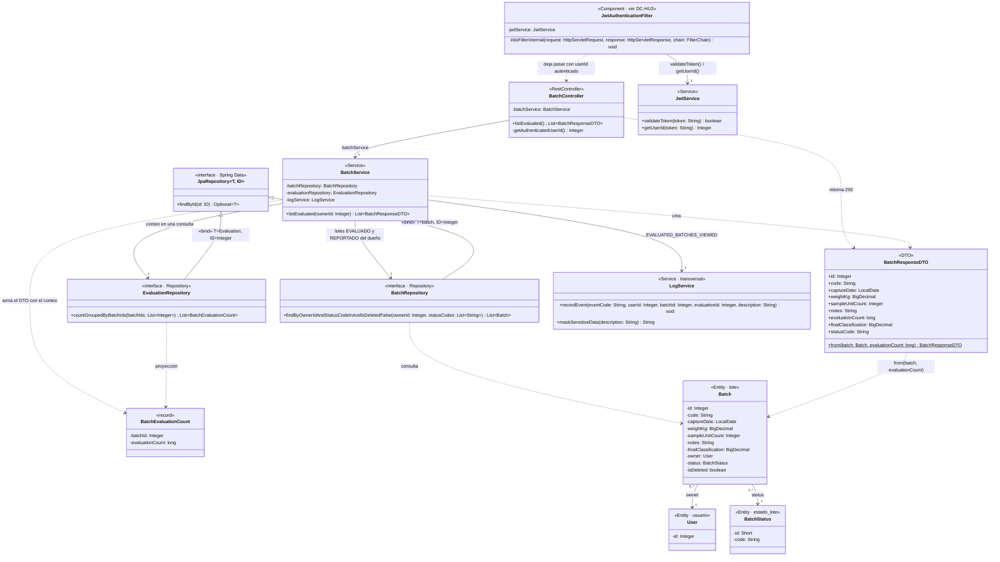

### DC-HU6

_DC-HU6 · Generar reporte del lote · Diagrama de clases_

```mermaid
classDiagram
direction TB
class ReportController {
  <<RestController>>
  -reportService: ReportService
  +generate(code: String) ReportResponseDTO
  -getAuthenticatedUserId() Integer
}
class ReportService {
  <<Service>>
  -batchRepository: BatchRepository
  -evaluationRepository: EvaluationRepository
  -statisticsCalculator: ReportStatisticsCalculator
  -reportGenerator: ReportGenerator
  -logService: LogService
  +generate(code: String, ownerId: Integer) ReportResponseDTO
  -findOwnBatch(code: String, ownerId: Integer) Batch
}
class ReportStatisticsCalculator {
  <<Component>>
  +calculate(evaluations: List~Evaluation~) ReportStatistics
}
class ReportGenerator {
  <<interface · puerto>>
  +renderChartPng(statistics: ReportStatistics) byte[]
}
class JasperReportGenerator {
  <<Component · JasperReports>>
  -chartReport: JasperReport
  +initCompileTemplates() void
  +renderChartPng(statistics: ReportStatistics) byte[]
}
class ReportStatistics {
  <<record · DTO>>
  -evaluationCount: long
  -finalClassification: BigDecimal
  -eyeAverage: BigDecimal
  -skinAverage: BigDecimal
  -countByCategory: Map~Short,Long~
}
class ReportResponseDTO {
  <<record · DTO>>
  -reportId: Integer
  -version: Integer
  -batchCode: String
  -captureDate: LocalDate
  -weightKg: BigDecimal
  -sampleUnitCount: Integer
  -notes: String
  -statistics: ReportStatistics
  -units: List~EvaluationResponseDTO~
  -chartImage: String
  +from(batch: Batch, evaluations: List~Evaluation~, statistics: ReportStatistics, chartPng: byte[]) ReportResponseDTO$
}
class JpaRepository~T, ID~ {
  <<interface · Spring Data>>
  +save(entity: T) T
}
class BatchRepository {
  <<interface · Repository>>
  +findByCodeAndOwnerIdAndIsDeletedFalse(code: String, ownerId: Integer) Optional~Batch~
}
class EvaluationRepository {
  <<interface · Repository>>
  +findByBatchId(batchId: Integer) List~Evaluation~
}
class Batch {
  <<Entity · lote>>
  -id: Integer
  -code: String
  -captureDate: LocalDate
  -weightKg: BigDecimal
  -sampleUnitCount: Integer
  -notes: String
  -finalClassification: BigDecimal
  -status: BatchStatus
  +getId() Integer
  +isEvaluated() boolean
}
class BatchStatus {
  <<Entity · estado_lote>>
  -id: Short
  -code: String
}
class Evaluation {
  <<Entity · evaluacion>>
  -id: Integer
  -batch: Batch
  -evaluatedAt: OffsetDateTime
  -points: List~EvaluationPoint~
}
class EvaluationPoint {
  <<Entity · punto_evaluacion>>
  -fishPart: FishPart
  -ntcCategory: Short
  -confidence: BigDecimal
}
class FishPart {
  <<Entity · parte_pez>>
  -id: Short
  -code: String
}
class ClassificationResult {
  <<DTO>>
  +fishPartCode: String
  +ntcCategory: Short
  +confidence: BigDecimal
}
class EvaluationResponseDTO {
  <<DTO>>
  +id: Integer
  +evaluatedAt: OffsetDateTime
  +results: List~ClassificationResult~
  +from(evaluation: Evaluation) EvaluationResponseDTO$
}
class LogService {
  <<Service · transversal>>
  +recordEvent(eventCode: String, userId: Integer, batchId: Integer, evaluationId: Integer, description: String) void
  +maskSensitiveData(description: String) String
}
class JwtService {
  <<Service>>
  +validateToken(token: String) boolean
  +getUserId(token: String) Integer
}
class JwtAuthenticationFilter {
  <<Component · ver DC-HU2>>
  -jwtService: JwtService
  #doFilterInternal(request: HttpServletRequest, response: HttpServletResponse, chain: FilterChain) void
}
class BusinessException {
  <<RuntimeException>>
  -httpStatus: int
  +getHttpStatus() int
}
class GlobalExceptionHandler {
  <<RestControllerAdvice>>
  +handleBusiness(exception: BusinessException) ResponseEntity~ErrorResponseDTO~
}
class ErrorResponseDTO {
  <<record · DTO>>
  -message: String
}

JwtAuthenticationFilter --> "1" JwtService : validateToken() / getUserId()
JwtAuthenticationFilter ..> ReportController : deja pasar con userId autenticado
ReportController --> "1" ReportService : reportService
ReportController ..> ReportResponseDTO : retorna 200
ReportService --> "1" BatchRepository : lote propio
ReportService --> "1" EvaluationRepository : evaluaciones del lote
ReportService --> "1" ReportStatisticsCalculator : calculate()
ReportService --> "1" ReportGenerator : renderChartPng()
ReportService --> "1" LogService : REPORT_GENERATED
ReportService ..> ReportResponseDTO : crea
ReportService ..> BusinessException : lanza 404 / 409
ReportGenerator <|.. JasperReportGenerator : implements
ReportStatisticsCalculator ..> ReportStatistics : crea
JasperReportGenerator ..> ReportStatistics : dibuja la gráfica
ReportResponseDTO *-- "1" ReportStatistics : statistics
JpaRepository <|-- BatchRepository : «bind» T=Batch, ID=Integer
JpaRepository <|-- EvaluationRepository : «bind» T=Evaluation, ID=Integer
BatchRepository ..> Batch : consulta
EvaluationRepository ..> Evaluation : consulta
Batch "0..*" --> "1" BatchStatus : status
Evaluation "0..*" --> "1" Batch : batch
Evaluation "1" *-- "1..*" EvaluationPoint : points
EvaluationPoint "0..*" --> "1" FishPart : fishPart
ReportResponseDTO ..> EvaluationResponseDTO : units
EvaluationResponseDTO *-- "1..*" ClassificationResult : results
EvaluationResponseDTO ..> Evaluation : from(evaluation)
GlobalExceptionHandler ..> BusinessException : maneja
GlobalExceptionHandler ..> ErrorResponseDTO : retorna 404 / 409

note for ReportStatisticsCalculator "Estadísticas: número de evaluaciones, clasificación final,<br>promedio de OJO, promedio de PIEL y conteo por categoría NTC 1..5."
note for JasperReportGenerator "initCompileTemplates (@PostConstruct) compila las plantillas .jrxml<br>una sola vez al iniciar (JasperCompileManager) en objetos JasperReport.<br>renderChartPng llena chartReport (JasperFillManager) y la exporta a PNG.<br>En el servidor: java.awt.headless=true y fuentes incluidas."
```

### DC-HU7

_DC-HU7 · Monitorear información del sistema · Diagrama de clases_

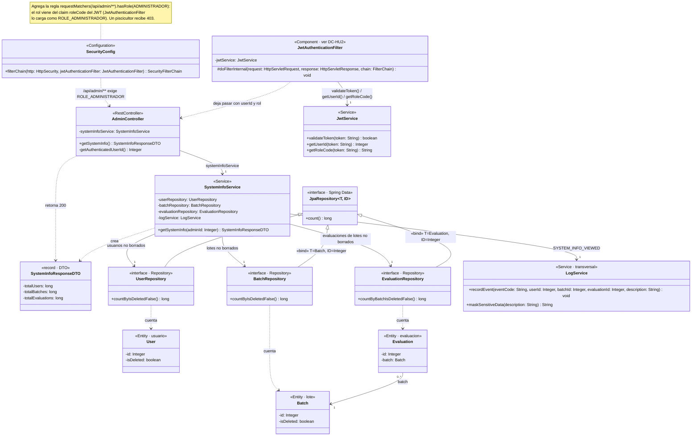

### DC-HU8

_DC-HU8 · Eliminar usuario · Diagrama de clases_

```mermaid
classDiagram
direction TB
class DispatcherServlet {
  <<Spring MVC>>
  #doDispatch(request: HttpServletRequest, response: HttpServletResponse) void
}
class UserController {
  <<RestController>>
  -userService: UserService
  +deleteAccount(request: DeleteAccountRequestDTO) void
  -getAuthenticatedUserId() Integer
}
class Validator {
  <<interface · Jakarta Bean Validation>>
  +validate(bean: T) Set~ConstraintViolation~
}
class DeleteAccountRequestDTO {
  <<DTO · bean validado>>
  -password: String [NotBlank]
  +getPassword() String
}
class UserService {
  <<Service>>
  -userRepository: UserRepository
  -batchRepository: BatchRepository
  -reportRepository: ReportRepository
  -passwordService: PasswordService
  -logService: LogService
  +deleteAccount(userId: Integer, request: DeleteAccountRequestDTO) void
}
class PasswordService {
  <<Service>>
  -secureRandom: SecureRandom
  +hashPassword(password: String, salt: String) String
  +verifyPassword(password: String, salt: String, passwordHash: String) boolean
}
class JpaRepository~T, ID~ {
  <<interface · Spring Data>>
  +findById(id: ID) Optional~T~
  +save(entity: T) T
  +saveAll(entities: List~T~) List~T~
}
class UserRepository {
  <<interface · Repository>>
  +findByIdAndIsDeletedFalse(id: Integer) Optional~User~
}
class BatchRepository {
  <<interface · Repository>>
  +findByOwnerIdAndIsDeletedFalse(ownerId: Integer) List~Batch~
}
class ReportRepository {
  <<interface · Repository>>
  +findByBatchOwnerIdAndIsDeletedFalse(ownerId: Integer) List~Report~
}
class User {
  <<Entity · usuario>>
  -id: Integer
  -passwordHash: String
  -salt: String
  -active: boolean
  -isDeleted: boolean
  -deletedAt: OffsetDateTime
  -deletedBy: Integer
  +getSalt() String
  +getPasswordHash() String
  +softDelete(userId: Integer) void
}
class Batch {
  <<Entity · lote>>
  -id: Integer
  -owner: User
  -isDeleted: boolean
  -deletedAt: OffsetDateTime
  -deletedBy: Integer
  +softDelete(userId: Integer) void
}
class Report {
  <<Entity · reporte>>
  -id: Integer
  -batch: Batch
  -isDeleted: boolean
  -deletedAt: OffsetDateTime
  -deletedBy: Integer
  +softDelete(userId: Integer) void
}
class LogService {
  <<Service · transversal>>
  +recordEvent(eventCode: String, userId: Integer, batchId: Integer, evaluationId: Integer, description: String) void
  +maskSensitiveData(description: String) String
}
class JwtService {
  <<Service>>
  +validateToken(token: String) boolean
  +getUserId(token: String) Integer
}
class JwtAuthenticationFilter {
  <<Component · ver DC-HU2>>
  -jwtService: JwtService
  #doFilterInternal(request: HttpServletRequest, response: HttpServletResponse, chain: FilterChain) void
}
class BusinessException {
  <<RuntimeException>>
  -httpStatus: int
  +getHttpStatus() int
}
class GlobalExceptionHandler {
  <<RestControllerAdvice>>
  +handleValidation(exception: MethodArgumentNotValidException) ResponseEntity~ErrorResponseDTO~
  +handleBusiness(exception: BusinessException) ResponseEntity~ErrorResponseDTO~
}
class ErrorResponseDTO {
  <<record · DTO>>
  -message: String
  -errors: List~FieldErrorDTO~
}
class FieldErrorDTO {
  <<record · DTO>>
  -field: String
  -message: String
}

JwtAuthenticationFilter --> "1" JwtService : validateToken() / getUserId()
JwtAuthenticationFilter ..> DispatcherServlet : deja pasar con userId autenticado
DispatcherServlet ..> Validator : @Valid activa validate()
DispatcherServlet ..> UserController : invoca deleteAccount(request)
UserController --> "1" UserService : userService
UserController ..> DeleteAccountRequestDTO : recibe con @Valid
note for UserController "POST /api/users/me/delete (no DELETE con cuerpo).<br>Contraseña incorrecta: 403, no 401, para que el<br>frontend no cierre la sesión del usuario."
Validator ..> DeleteAccountRequestDTO : valida anotaciones del bean
UserService ..> DeleteAccountRequestDTO : lee password
UserService --> "1" PasswordService : verifyPassword(password, salt, passwordHash)
UserService --> "1" UserRepository : findByIdAndIsDeletedFalse() / save()
UserService --> "1" BatchRepository : lotes del usuario / saveAll()
UserService --> "1" ReportRepository : reportes del usuario / saveAll()
UserService --> "1" LogService : USER_DELETED
UserService ..> User : lee salt y passwordHash, softDelete()
UserService ..> Batch : softDelete()
UserService ..> Report : softDelete()
UserService ..> BusinessException : lanza 403 / 404
JpaRepository <|-- UserRepository : «bind» T=User, ID=Integer
JpaRepository <|-- BatchRepository : «bind» T=Batch, ID=Integer
JpaRepository <|-- ReportRepository : «bind» T=Report, ID=Integer
Batch "0..*" --> "1" User : owner
Report "0..*" --> "1" Batch : batch
GlobalExceptionHandler ..> BusinessException : maneja
GlobalExceptionHandler ..> ErrorResponseDTO : retorna 400 / 403 / 404
ErrorResponseDTO *-- "0..*" FieldErrorDTO : errors

note for User "softDelete: isDeleted = true, active = false, deletedAt = ahora<br>y deletedBy = el mismo usuario (relación reflexiva usuario.deleted_by).<br>Desde ahí el login responde 401, porque AuthService rechaza isDeleted."
note for UserService "Ocultamiento en cascada: primero los lotes y reportes del<br>usuario y luego la cuenta, en una sola transacción."
```

### DC-HU9

_DC-HU9 · Eliminar lote · Diagrama de clases_

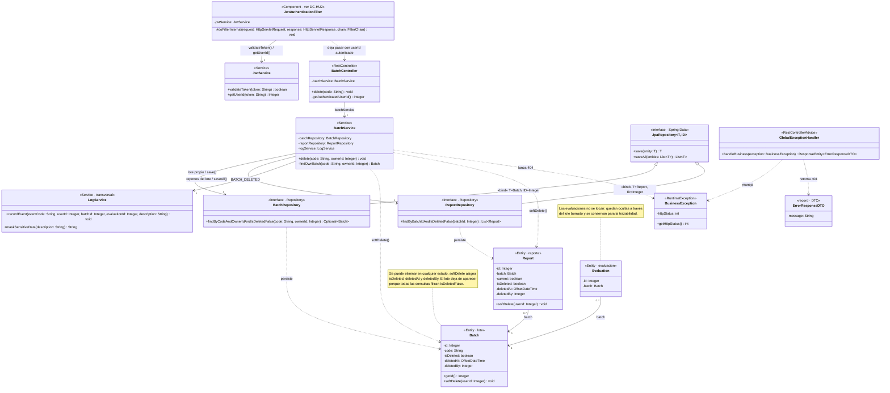

### DC-HU10

_DC-HU10 · Guardar reporte · Diagrama de clases_

```mermaid
classDiagram
direction TB
class ReportController {
  <<RestController>>
  -reportService: ReportService
  +save(code: String) ReportSummaryDTO
  -getAuthenticatedUserId() Integer
}
class ReportService {
  <<Service>>
  -batchRepository: BatchRepository
  -statusRepository: BatchStatusRepository
  -evaluationRepository: EvaluationRepository
  -reportRepository: ReportRepository
  -statisticsCalculator: ReportStatisticsCalculator
  -logService: LogService
  +save(code: String, ownerId: Integer) ReportSummaryDTO
  -findOwnBatch(code: String, ownerId: Integer) Batch
}
class ReportStatisticsCalculator {
  <<Component>>
  +calculate(evaluations: List~Evaluation~) ReportStatistics
}
class ReportStatistics {
  <<record · DTO>>
  -evaluationCount: long
  -finalClassification: BigDecimal
  -eyeAverage: BigDecimal
  -skinAverage: BigDecimal
  -countByCategory: Map~Short,Long~
  +toJson() String
}
class ReportSummaryDTO {
  <<record · DTO>>
  -id: Integer
  -batchCode: String
  -version: Integer
  -current: boolean
  -finalClassification: BigDecimal
  -generatedAt: OffsetDateTime
  +from(report: Report) ReportSummaryDTO$
}
class JpaRepository~T, ID~ {
  <<interface · Spring Data>>
  +save(entity: T) T
}
class BatchRepository {
  <<interface · Repository>>
  +findByCodeAndOwnerIdAndIsDeletedFalse(code: String, ownerId: Integer) Optional~Batch~
}
class BatchStatusRepository {
  <<interface · Repository>>
  +findByCode(code: String) Optional~BatchStatus~
}
class EvaluationRepository {
  <<interface · Repository>>
  +findByBatchId(batchId: Integer) List~Evaluation~
}
class ReportRepository {
  <<interface · Repository>>
  +findMaxVersionByBatchId(batchId: Integer) int
}
class Report {
  <<Entity · reporte>>
  -id: Integer
  -batch: Batch
  -version: Integer
  -current: boolean
  -finalClassification: BigDecimal
  -evaluationCount: Integer
  -statistics: String
  -generatedAt: OffsetDateTime
  -isDeleted: boolean
  -deletedAt: OffsetDateTime
  -deletedBy: Integer
  -createdAt: OffsetDateTime
  -updatedAt: OffsetDateTime
  +Report(batch: Batch, version: Integer, statistics: ReportStatistics)
}
class Batch {
  <<Entity · lote>>
  -id: Integer
  -code: String
  -finalClassification: BigDecimal
  -status: BatchStatus
  +getId() Integer
  +canBeReported() boolean
  +markReported(reported: BatchStatus) void
}
class BatchStatus {
  <<Entity · estado_lote>>
  +REPORTED: String = "REPORTADO"$
  -id: Short
  -code: String
}
class Evaluation {
  <<Entity · evaluacion>>
  -id: Integer
  -batch: Batch
  -points: List~EvaluationPoint~
}
class EvaluationPoint {
  <<Entity · punto_evaluacion>>
  -fishPart: FishPart
  -ntcCategory: Short
  -confidence: BigDecimal
}
class FishPart {
  <<Entity · parte_pez>>
  -id: Short
  -code: String
}
class LogService {
  <<Service · transversal>>
  +recordEvent(eventCode: String, userId: Integer, batchId: Integer, evaluationId: Integer, description: String) void
  +maskSensitiveData(description: String) String
}
class JwtService {
  <<Service>>
  +validateToken(token: String) boolean
  +getUserId(token: String) Integer
}
class JwtAuthenticationFilter {
  <<Component · ver DC-HU2>>
  -jwtService: JwtService
  #doFilterInternal(request: HttpServletRequest, response: HttpServletResponse, chain: FilterChain) void
}
class BusinessException {
  <<RuntimeException>>
  -httpStatus: int
  +getHttpStatus() int
}
class GlobalExceptionHandler {
  <<RestControllerAdvice>>
  +handleBusiness(exception: BusinessException) ResponseEntity~ErrorResponseDTO~
}
class ErrorResponseDTO {
  <<record · DTO>>
  -message: String
}

JwtAuthenticationFilter --> "1" JwtService : validateToken() / getUserId()
JwtAuthenticationFilter ..> ReportController : deja pasar con userId autenticado
ReportController --> "1" ReportService : reportService
ReportController ..> ReportSummaryDTO : retorna 201
ReportService --> "1" BatchRepository : lote propio / save()
ReportService --> "1" BatchStatusRepository : REPORTADO
ReportService --> "1" EvaluationRepository : evaluaciones del lote
ReportService --> "1" ReportRepository : siguiente versión / save()
ReportService --> "1" ReportStatisticsCalculator : calculate()
ReportService --> "1" LogService : REPORT_SAVED
ReportService ..> Report : crea versión vigente
ReportService ..> ReportSummaryDTO : crea
ReportService ..> BusinessException : lanza 404 / 409
ReportStatisticsCalculator ..> ReportStatistics : crea
Report ..> ReportStatistics : guarda toJson() en estadisticas
JpaRepository <|-- BatchRepository : «bind» T=Batch, ID=Integer
JpaRepository <|-- BatchStatusRepository : «bind» T=BatchStatus, ID=Short
JpaRepository <|-- EvaluationRepository : «bind» T=Evaluation, ID=Integer
JpaRepository <|-- ReportRepository : «bind» T=Report, ID=Integer
ReportRepository ..> Report : persiste
Report "0..*" --> "1" Batch : batch
Batch "0..*" --> "1" BatchStatus : status
Evaluation "0..*" --> "1" Batch : batch
Evaluation "1" *-- "1..*" EvaluationPoint : points
EvaluationPoint "0..*" --> "1" FishPart : fishPart
GlobalExceptionHandler ..> BusinessException : maneja
GlobalExceptionHandler ..> ErrorResponseDTO : retorna 404 / 409

note for Report "Historial de versiones: cada guardado crea una versión nueva<br>(version = máxima + 1) con current = true. Solo una versión<br>vigente por lote: UNIQUE (lote_id) WHERE vigente AND NOT is_deleted.<br>statistics se guarda como jsonb (copia congelada)."
note for Batch "canBeReported: true solo si el estado es EVALUADO. Un lote<br>REPORTADO ya tiene versión vigente: para guardar otra, primero se<br>amplía la muestra (HU-13) o se elimina el reporte (HU-14).<br>markReported asigna el estado REPORTADO.<br>La clasificación final se conserva (ck_lote_estado_clasificacion)."
```

### DC-HU11

_DC-HU11 · Consultar reporte · Diagrama de clases_

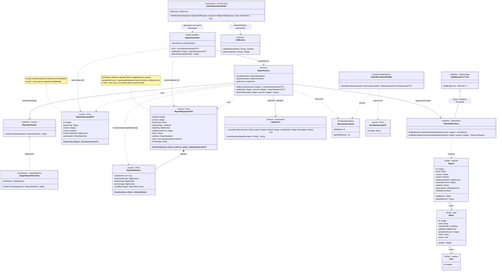

### DC-HU12

_DC-HU12 · Exportar reporte a PDF · Diagrama de clases_

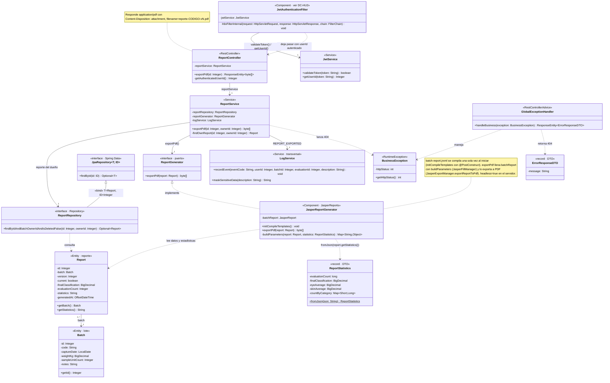

### DC-HU13

_DC-HU13 · Ampliar muestra del lote · Diagrama de clases_

```mermaid
classDiagram
direction TB
class DispatcherServlet {
  <<Spring MVC>>
  #doDispatch(request: HttpServletRequest, response: HttpServletResponse) void
}
class BatchController {
  <<RestController>>
  -batchService: BatchService
  +expandSample(code: String, request: ExpandSampleRequestDTO) BatchResponseDTO
  -getAuthenticatedUserId() Integer
}
class Validator {
  <<interface · Jakarta Bean Validation>>
  +validate(bean: T) Set~ConstraintViolation~
}
class ExpandSampleRequestDTO {
  <<DTO · bean validado>>
  -additionalUnits: Integer [NotNull, Min 1, Max 499]
  +getAdditionalUnits() Integer
}
class BatchService {
  <<Service>>
  -batchRepository: BatchRepository
  -statusRepository: BatchStatusRepository
  -reportRepository: ReportRepository
  -evaluationRepository: EvaluationRepository
  -logService: LogService
  +expandSample(code: String, ownerId: Integer, request: ExpandSampleRequestDTO) BatchResponseDTO
  -findOwnBatch(code: String, ownerId: Integer) Batch
}
class BatchResponseDTO {
  <<DTO>>
  +id: Integer
  +code: String
  +captureDate: LocalDate
  +weightKg: BigDecimal
  +sampleUnitCount: Integer
  +notes: String
  +evaluationCount: long
  +finalClassification: BigDecimal
  +statusCode: String
  +from(batch: Batch, evaluationCount: long) BatchResponseDTO$
}
class JpaRepository~T, ID~ {
  <<interface · Spring Data>>
  +save(entity: T) T
}
class BatchRepository {
  <<interface · Repository>>
  +findByCodeAndOwnerIdAndIsDeletedFalse(code: String, ownerId: Integer) Optional~Batch~
}
class BatchStatusRepository {
  <<interface · Repository>>
  +findByCode(code: String) Optional~BatchStatus~
}
class ReportRepository {
  <<interface · Repository>>
  +findByBatchIdAndCurrentTrueAndIsDeletedFalse(batchId: Integer) Optional~Report~
}
class EvaluationRepository {
  <<interface · Repository>>
  +countByBatchId(batchId: Integer) long
}
class Batch {
  <<Entity · lote>>
  -id: Integer
  -code: String
  -captureDate: LocalDate
  -weightKg: BigDecimal
  -sampleUnitCount: Integer
  -notes: String
  -finalClassification: BigDecimal
  -status: BatchStatus
  +getId() Integer
  +isEvaluated() boolean
  +isReported() boolean
  +expandSample(additionalUnits: Integer, inEvaluation: BatchStatus) void
}
class BatchStatus {
  <<Entity · estado_lote>>
  -id: Short
  -code: String
}
class Report {
  <<Entity · reporte>>
  -id: Integer
  -version: Integer
  -current: boolean
  +markAsPrevious() void
}
class LogService {
  <<Service · transversal>>
  +recordEvent(eventCode: String, userId: Integer, batchId: Integer, evaluationId: Integer, description: String) void
  +maskSensitiveData(description: String) String
}
class JwtService {
  <<Service>>
  +validateToken(token: String) boolean
  +getUserId(token: String) Integer
}
class JwtAuthenticationFilter {
  <<Component · ver DC-HU2>>
  -jwtService: JwtService
  #doFilterInternal(request: HttpServletRequest, response: HttpServletResponse, chain: FilterChain) void
}
class BusinessException {
  <<RuntimeException>>
  -httpStatus: int
  +getHttpStatus() int
}
class GlobalExceptionHandler {
  <<RestControllerAdvice>>
  +handleValidation(exception: MethodArgumentNotValidException) ResponseEntity~ErrorResponseDTO~
  +handleBusiness(exception: BusinessException) ResponseEntity~ErrorResponseDTO~
}
class ErrorResponseDTO {
  <<record · DTO>>
  -message: String
  -errors: List~FieldErrorDTO~
}
class FieldErrorDTO {
  <<record · DTO>>
  -field: String
  -message: String
}

JwtAuthenticationFilter --> "1" JwtService : validateToken() / getUserId()
JwtAuthenticationFilter ..> DispatcherServlet : deja pasar con userId autenticado
DispatcherServlet ..> Validator : @Valid activa validate()
DispatcherServlet ..> BatchController : invoca expandSample(code, request)
BatchController --> "1" BatchService : batchService
BatchController ..> ExpandSampleRequestDTO : recibe con @Valid
Validator ..> ExpandSampleRequestDTO : valida anotaciones del bean
BatchController ..> BatchResponseDTO : retorna 200
BatchService ..> ExpandSampleRequestDTO : lee additionalUnits
BatchService --> "1" BatchRepository : lote propio / save()
BatchService --> "1" BatchStatusRepository : EN_EVALUACION
BatchService --> "1" ReportRepository : versión vigente / save()
BatchService --> "1" EvaluationRepository : countByBatchId()
BatchService --> "1" LogService : SAMPLE_EXPANDED
BatchService ..> Batch : expandSample()
BatchService ..> Report : markAsPrevious()
BatchService ..> BatchResponseDTO : crea
BatchService ..> BusinessException : lanza 400 / 404 / 409
JpaRepository <|-- BatchRepository : «bind» T=Batch, ID=Integer
JpaRepository <|-- BatchStatusRepository : «bind» T=BatchStatus, ID=Short
JpaRepository <|-- ReportRepository : «bind» T=Report, ID=Integer
JpaRepository <|-- EvaluationRepository : «bind» T=Evaluation, ID=Integer
Batch "0..*" --> "1" BatchStatus : status
Report "0..*" --> "1" Batch : batch
GlobalExceptionHandler ..> BusinessException : maneja
GlobalExceptionHandler ..> ErrorResponseDTO : retorna 400 / 404 / 409
ErrorResponseDTO *-- "0..*" FieldErrorDTO : errors

note for Batch "expandSample: sampleUnitCount += additionalUnits (máximo 500 en total),<br>estado EN_EVALUACION y finalClassification = null, porque<br>ck_lote_estado_clasificacion la exige solo en EVALUADO o REPORTADO.<br>Las unidades nuevas se evalúan y el lote se cierra con el flujo de HU-04."
note for Report "markAsPrevious: current = false. El reporte queda como<br>versión anterior (no se elimina), para conservar la trazabilidad."
```

### DC-HU14

_DC-HU14 · Eliminar reporte · Diagrama de clases_

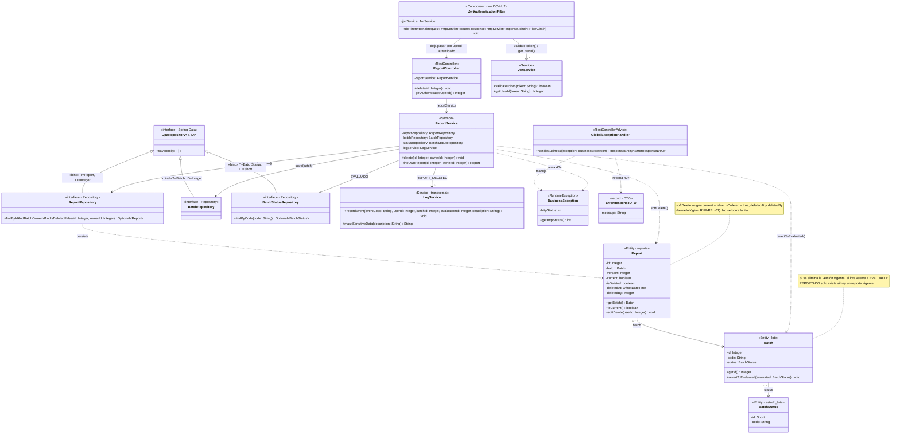

### DC-LT

_DC-LT · Auditoría (Log) · Diagrama de clases transversal_

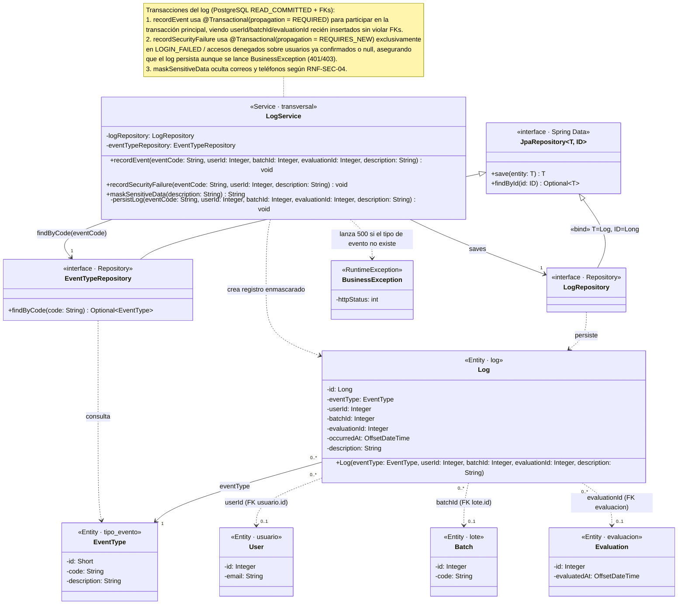

---

## Diagramas de secuencia

### DS-HU1

_DS-HU1 · Registrar usuario · Diagrama de secuencia_

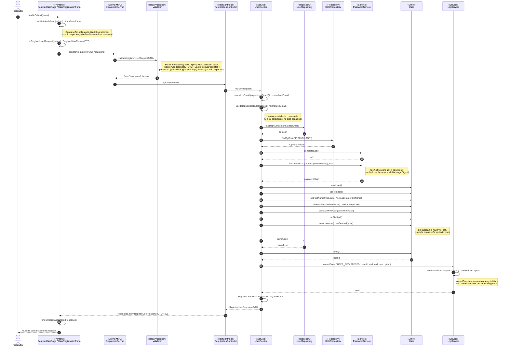

### DS-HU2-login

_DS-HU2 · Iniciar sesión · Diagrama de secuencia_

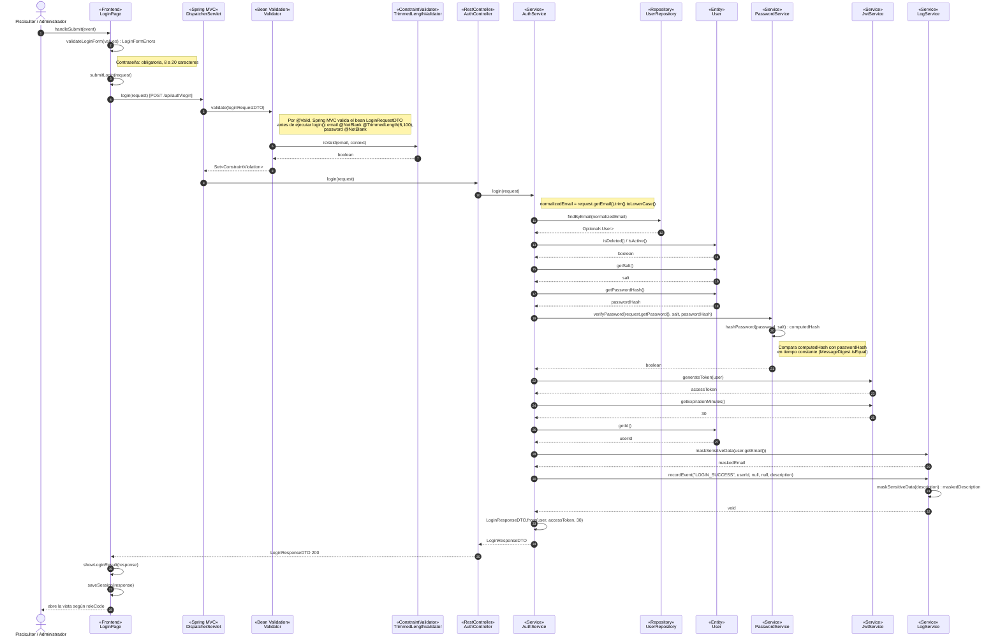

### DS-HU2-logout

_DS-HU2 · Cerrar sesión · Diagrama de secuencia_

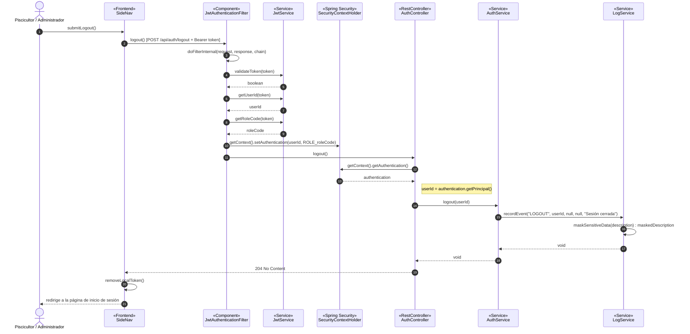

### DS-HU3

_DS-HU3 · Registrar lote · Diagrama de secuencia_

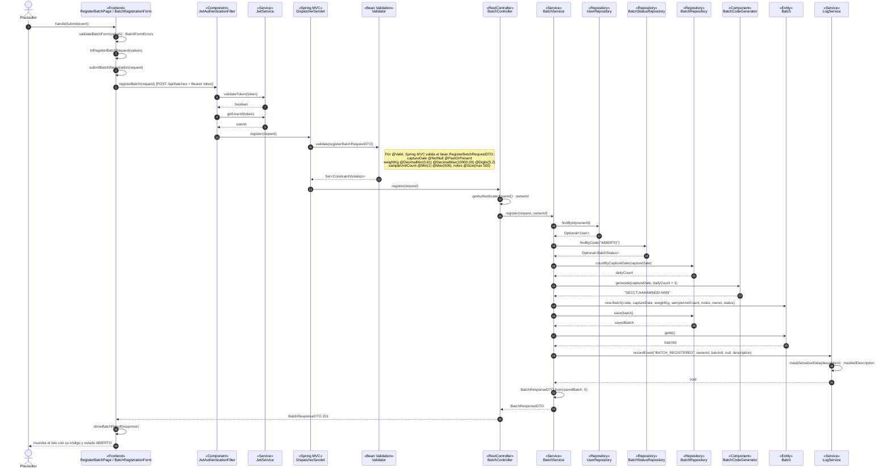

### DS-HU4-listar

_DS-HU4 · Listar y seleccionar lote · Diagrama de secuencia_

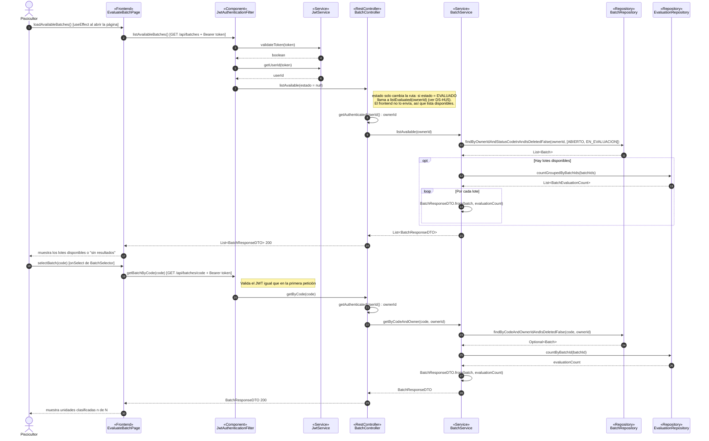

### DS-HU4-evaluar

_DS-HU4 · Evaluar unidad · Diagrama de secuencia_

```mermaid
sequenceDiagram
autonumber
actor P as Piscicultor
participant FE as «Frontend»<br>EvaluateBatchPage / UnitImageForm
participant F as «Component»<br>JwtAuthenticationFilter
participant EC as «RestController»<br>EvaluationController
participant ES as «Service»<br>EvaluationService
participant BR as «Repository»<br>BatchRepository
participant B as «Entity»<br>Batch
participant IV as «Component»<br>ImageValidator
participant ER as «Repository»<br>EvaluationRepository
participant CL as «Component»<br>HttpCnnClassifier
participant GS as «librería JSON»<br>Gson
participant HC as «java.net.http»<br>HttpClient
participant CNN as «external system · FastAPI»<br>servicio_inferencia
participant SR as «Repository»<br>BatchStatusRepository
participant FR as «Repository»<br>FishPartRepository
participant EV as «Entity»<br>Evaluation
participant LS as «Service»<br>LogService
participant GEH as «RestControllerAdvice»<br>GlobalExceptionHandler

P->>FE: handleUpload()
FE->>FE: validateImageFile(file) : string | null
FE->>FE: submitUnitEvaluation(code, image)
FE->>F: evaluateUnit(code, image) [POST multipart + Bearer token]
Note right of F: Valida el JWT igual que en DS-HU3
F->>EC: evaluateUnit(code, image)
EC->>EC: getAuthenticatedUserId() : ownerId
EC->>ES: evaluateUnit(code, ownerId, image.getBytes())
ES->>ES: findOwnBatch(code, ownerId)
ES->>BR: findByCodeAndOwnerIdAndIsDeletedFalse(code, ownerId)
BR-->>ES: Optional<Batch>
ES->>ES: ensureOpenForEvaluation(batch)
ES->>B: isOpenForEvaluation()
B-->>ES: boolean
ES->>IV: validateSize(image, MAX_IMAGE_BYTES)
ES->>IV: validateFormat(image)
Note right of IV: Revisa los primeros bytes del archivo<br>(firma JPG o PNG), no la extensión
ES->>ER: countByBatchId(batchId)
ER-->>ES: evaluationCount
ES->>ES: generateImageReference(image) : SHA-256 hex
ES->>ER: existsByBatchIdAndImageReference(batchId, imageReference)
ER-->>ES: boolean
ES->>CL: classify(image)
CL->>CL: Base64.getEncoder().encodeToString(image) : imagenBase64
CL->>GS: toJson(requestBody)
GS-->>CL: jsonBody
CL->>HC: send(request, BodyHandlers.ofString())
HC->>CNN: evaluar(req) [POST /evaluar · Content-Type application/json]
Note right of HC: {"imagen_base64": "iVBORw0KGgo..."}
CNN->>CNN: _inferir(imagen_bytes) : dict
Note right of CNN: Redimensiona a 224x224 y ejecuta model.predict<br>categoria_ntc = ceil(score x 5), confianza = score
alt El servicio responde 200
  CNN-->>HC: 200 OK + JSON
  Note right of HC: {"partes": [<br>{"parte": "OJO", "categoria_ntc": 4, "confianza": 0.93},<br>{"parte": "PIEL", "categoria_ntc": 3, "confianza": 0.88}]}
  HC-->>CL: HttpResponse<String>
  CL->>CL: parseResults(response.body()) : List<ClassificationResult>
  Note right of CL: Traduce parte, categoria_ntc y confianza a<br>fishPartCode, ntcCategory y confidence.<br>Exige OJO y PIEL una vez, 1..5 y 0..1
  CL-->>ES: List<ClassificationResult>
else Sin conexión, timeout, estado distinto de 200 o JSON inválido
  CNN-->>HC: 400 / 500 o sin respuesta
  HC-->>CL: HttpResponse<String> o IOException
  CL--xES: BusinessException(UNAVAILABLE_MESSAGE, 503)
  ES--xGEH: BusinessException (rollback de @Transactional)
  GEH->>GEH: handleBusiness(exception)
  GEH-->>FE: ErrorResponseDTO 503
  FE->>FE: setPageError(toMessage(error))
  FE-->>P: "El servicio de clasificación no está disponible"
end
Note over ES,CL: El caso de uso continúa solo si el clasificador respondió 200
ES->>EV: new Evaluation(batch, imageReference)
loop Por cada resultado (OJO, PIEL)
  ES->>FR: findByCode(fishPartCode)
  FR-->>ES: Optional<FishPart>
  ES->>EV: addPoint(fishPart, ntcCategory, confidence)
end
ES->>ER: save(evaluation)
ER-->>ES: savedEvaluation
opt Primera unidad del lote (estado ABIERTO)
  ES->>ES: findStatus("EN_EVALUACION")
  ES->>SR: findByCode("EN_EVALUACION")
  SR-->>ES: Optional<BatchStatus>
  ES->>B: startEvaluation(inEvaluation)
  ES->>BR: save(batch)
  BR-->>ES: savedBatch
end
ES->>LS: recordEvent("UNIT_EVALUATED", ownerId, batchId, evaluationId, description)
LS->>LS: maskSensitiveData(description) : maskedDescription
LS-->>ES: void
ES->>ES: EvaluationResponseDTO.from(savedEvaluation)
ES-->>EC: EvaluationResponseDTO
EC-->>FE: EvaluationResponseDTO 201
FE->>FE: getBatchByCode(code)
FE-->>P: muestra categoría y confianza de OJO y PIEL
```

### DS-HU4-cerrar

_DS-HU4 · Cerrar evaluación · Diagrama de secuencia_

```mermaid
sequenceDiagram
autonumber
actor P as Piscicultor
participant FE as «Frontend»<br>EvaluateBatchPage / UnitResultsCard
participant F as «Component»<br>JwtAuthenticationFilter
participant EC as «RestController»<br>EvaluationController
participant ES as «Service»<br>EvaluationService
participant BR as «Repository»<br>BatchRepository
participant B as «Entity»<br>Batch
participant ER as «Repository»<br>EvaluationRepository
participant SR as «Repository»<br>BatchStatusRepository
participant LS as «Service»<br>LogService

P->>FE: closeEvaluation(code) [onClose de UnitResultsCard]
FE->>F: requestCloseEvaluation(code) [POST /api/evaluations/batches/code/close]
Note right of F: Valida el JWT igual que en DS-HU3
F->>EC: close(code)
EC->>EC: getAuthenticatedUserId() : ownerId
EC->>ES: closeEvaluation(code, ownerId)
ES->>ES: findOwnBatch(code, ownerId)
ES->>BR: findByCodeAndOwnerIdAndIsDeletedFalse(code, ownerId)
BR-->>ES: Optional<Batch>
ES->>ES: ensureOpenForEvaluation(batch)
ES->>B: isOpenForEvaluation()
B-->>ES: boolean
ES->>ER: countByBatchId(batchId)
ER-->>ES: evaluationCount
ES->>ES: calculateFinalClassification(batchId)
ES->>ER: averageNtcCategoryByBatchId(batchId)
ER-->>ES: BigDecimal
Note right of ES: Promedio de la categoría NTC de todos los puntos,<br>redondeado a 2 decimales (HALF_UP)
ES->>ES: findStatus("EVALUADO")
ES->>SR: findByCode("EVALUADO")
SR-->>ES: Optional<BatchStatus>
ES->>B: close(finalClassification, evaluated)
Note right of B: Asigna estado EVALUADO y clasificación final juntos
ES->>BR: save(batch)
BR-->>ES: savedBatch
ES->>LS: recordEvent("EVALUATION_CLOSED", ownerId, batchId, null, description)
LS->>LS: maskSensitiveData(description) : maskedDescription
LS-->>ES: void
ES->>ES: BatchResponseDTO.from(batch, evaluationCount)
ES-->>EC: BatchResponseDTO
EC-->>FE: BatchResponseDTO 200
FE->>FE: loadAvailableBatches()
FE-->>P: muestra la clasificación final del lote
```

### DS-HU5

_DS-HU5 · Consultar lotes evaluados · Diagrama de secuencia_

```mermaid
sequenceDiagram
autonumber
actor P as Piscicultor
participant FE as «Frontend»<br>EvaluatedBatchesPage
participant F as «Component»<br>JwtAuthenticationFilter
participant JS as «Service»<br>JwtService
participant BC as «RestController»<br>BatchController
participant BS as «Service»<br>BatchService
participant BR as «Repository»<br>BatchRepository
participant ER as «Repository»<br>EvaluationRepository
participant LS as «Service»<br>LogService

P->>FE: consultEvaluatedBatches() [useEffect al abrir la página]
FE->>F: consultEvaluatedBatches() [GET /api/batches/evaluated + Bearer token]
F->>JS: validateToken(token)
JS-->>F: boolean
F->>JS: getUserId(token)
JS-->>F: userId
F->>BC: listEvaluated()
BC->>BC: getAuthenticatedUserId() : ownerId
BC->>BS: listEvaluated(ownerId)
BS->>BR: findByOwnerIdAndStatusCodeInAndIsDeletedFalse(ownerId, [EVALUADO, REPORTADO])
BR-->>BS: List<Batch>
opt Hay lotes evaluados
  BS->>ER: countGroupedByBatchIds(batchIds)
  ER-->>BS: List<BatchEvaluationCount>
end
loop Por cada lote (0 vueltas si la lista está vacía)
  BS->>BS: BatchResponseDTO.from(batch, evaluationCount)
end
BS->>LS: recordEvent("EVALUATED_BATCHES_VIEWED", ownerId, null, null, description)
LS->>LS: maskSensitiveData(description) : maskedDescription
LS-->>BS: void
BS-->>BC: List<BatchResponseDTO>
BC-->>FE: List<BatchResponseDTO> 200
alt Lista vacía
  FE->>FE: showEmptyResults()
  FE-->>P: muestra "sin resultados"
else Hay lotes
  FE->>FE: showEvaluatedBatches(data)
  FE-->>P: muestra código, fecha, peso, unidades, observaciones, evaluaciones y clasificación final
end
```

### DS-HU6

_DS-HU6 · Generar reporte del lote · Diagrama de secuencia_

```mermaid
sequenceDiagram
autonumber
actor P as Piscicultor
participant FE as «Frontend»<br>EvaluatedBatchesPage / ReportPage
participant F as «Component»<br>JwtAuthenticationFilter
participant RC as «RestController»<br>ReportController
participant RS as «Service»<br>ReportService
participant BR as «Repository»<br>BatchRepository
participant B as «Entity»<br>Batch
participant ER as «Repository»<br>EvaluationRepository
participant SC as «Component»<br>ReportStatisticsCalculator
participant RG as «Component»<br>JasperReportGenerator
participant LS as «Service»<br>LogService

P->>FE: generateBatchReport(code) [botón Generar reporte]
FE->>F: getBatchReport(code) [GET /api/reports/batches/code + Bearer token]
Note right of F: Valida el JWT igual que en DS-HU3
F->>RC: generate(code)
RC->>RC: getAuthenticatedUserId() : ownerId
RC->>RS: generate(code, ownerId)
RS->>RS: findOwnBatch(code, ownerId)
RS->>BR: findByCodeAndOwnerIdAndIsDeletedFalse(code, ownerId)
BR-->>RS: Optional<Batch>
RS->>B: isEvaluated()
B-->>RS: boolean
Note right of B: true si el estado es EVALUADO o REPORTADO
RS->>ER: findByBatchId(batchId)
ER-->>RS: List<Evaluation>
RS->>SC: calculate(evaluations)
SC-->>RS: ReportStatistics
RS->>RG: renderChartPng(statistics)
Note right of RG: JasperReports llena la plantilla de la gráfica<br>(unidades por categoría NTC) y la exporta a PNG
RG-->>RS: byte[] chartPng
RS->>RS: ReportResponseDTO.from(batch, evaluations, statistics, chartPng)
RS->>LS: recordEvent("REPORT_GENERATED", ownerId, batchId, null, description)
LS->>LS: maskSensitiveData(description) : maskedDescription
LS-->>RS: void
RS-->>RC: ReportResponseDTO
RC-->>FE: ReportResponseDTO 200
FE->>FE: showReport(response)
FE-->>P: muestra datos del lote, resultados por unidad, estadísticas y gráfica
```

### DS-HU7

_DS-HU7 · Monitorear información del sistema · Diagrama de secuencia_

```mermaid
sequenceDiagram
autonumber
actor A as Administrador
participant FE as «Frontend»<br>AdminPage
participant F as «Component»<br>JwtAuthenticationFilter
participant JS as «Service»<br>JwtService
participant AC as «RestController»<br>AdminController
participant SS as «Service»<br>SystemInfoService
participant UR as «Repository»<br>UserRepository
participant BR as «Repository»<br>BatchRepository
participant ER as «Repository»<br>EvaluationRepository
participant LS as «Service»<br>LogService

A->>FE: loadSystemInfo() [useEffect al abrir la página]
FE->>F: getSystemInfo() [GET /api/admin/system-info + Bearer token]
F->>JS: validateToken(token)
JS-->>F: boolean
F->>JS: getUserId(token)
JS-->>F: userId
F->>JS: getRoleCode(token)
JS-->>F: "ADMINISTRADOR"
Note right of F: Carga ROLE_ADMINISTRADOR en el contexto.<br>SecurityConfig exige ese rol para /api/admin/**
F->>AC: getSystemInfo()
AC->>AC: getAuthenticatedUserId() : adminId
AC->>SS: getSystemInfo(adminId)
SS->>UR: countByIsDeletedFalse()
UR-->>SS: totalUsers
SS->>BR: countByIsDeletedFalse()
BR-->>SS: totalBatches
SS->>ER: countByBatchIsDeletedFalse()
ER-->>SS: totalEvaluations
SS->>SS: new SystemInfoResponseDTO(totalUsers, totalBatches, totalEvaluations)
SS->>LS: recordEvent("SYSTEM_INFO_VIEWED", adminId, null, null, description)
LS->>LS: maskSensitiveData(description) : maskedDescription
LS-->>SS: void
SS-->>AC: SystemInfoResponseDTO
AC-->>FE: SystemInfoResponseDTO 200
FE->>FE: showSystemInfo(response)
FE-->>A: muestra total de usuarios, lotes y evaluaciones
```

### DS-HU8

_DS-HU8 · Eliminar usuario · Diagrama de secuencia_

```mermaid
sequenceDiagram
autonumber
actor P as Piscicultor
participant FE as «Frontend»<br>ProfilePage
participant F as «Component»<br>JwtAuthenticationFilter
participant DS as «Spring MVC»<br>DispatcherServlet
participant V as «Bean Validation»<br>Validator
participant UC as «RestController»<br>UserController
participant US as «Service»<br>UserService
participant UR as «Repository»<br>UserRepository
participant U as «Entity»<br>User
participant PS as «Service»<br>PasswordService
participant BR as «Repository»<br>BatchRepository
participant B as «Entity»<br>Batch
participant RR as «Repository»<br>ReportRepository
participant R as «Entity»<br>Report
participant LS as «Service»<br>LogService

P->>FE: handleDeleteAccount(event) [contraseña + confirmación]
FE->>FE: validateDeleteAccountForm(values) : DeleteAccountFormErrors
FE->>F: deleteAccount(request) [POST /api/users/me/delete + Bearer token]
Note right of F: Valida el JWT igual que en DS-HU3
F->>DS: deleteAccount(request)
DS->>V: validate(deleteAccountRequestDTO)
Note right of V: Por @Valid, Spring MVC valida el bean<br>DeleteAccountRequestDTO: password @NotBlank
V-->>DS: Set<ConstraintViolation>
DS->>UC: deleteAccount(request)
UC->>UC: getAuthenticatedUserId() : userId
UC->>US: deleteAccount(userId, request)
US->>UR: findByIdAndIsDeletedFalse(userId)
UR-->>US: Optional<User>
US->>U: getSalt()
U-->>US: salt
US->>U: getPasswordHash()
U-->>US: passwordHash
US->>PS: verifyPassword(request.getPassword(), salt, passwordHash)
PS->>PS: hashPassword(password, salt) : computedHash
Note right of PS: Compara en tiempo constante (MessageDigest.isEqual)
PS-->>US: boolean
US->>BR: findByOwnerIdAndIsDeletedFalse(userId)
BR-->>US: List<Batch>
loop Por cada lote del usuario
  US->>B: softDelete(userId)
end
US->>BR: saveAll(batches)
BR-->>US: List<Batch>
US->>RR: findByBatchOwnerIdAndIsDeletedFalse(userId)
RR-->>US: List<Report>
loop Por cada reporte del usuario
  US->>R: softDelete(userId)
end
US->>RR: saveAll(reports)
RR-->>US: List<Report>
US->>U: softDelete(userId)
Note right of U: isDeleted = true, active = false,<br>deletedAt = ahora, deletedBy = userId
US->>UR: save(user)
UR-->>US: savedUser
US->>LS: recordEvent("USER_DELETED", userId, null, null, description)
LS->>LS: maskSensitiveData(description) : maskedDescription
LS-->>US: void
US-->>UC: void
UC-->>FE: 204 No Content
FE->>FE: removeLocalToken()
FE-->>P: redirige a la página de inicio de sesión
```

### DS-HU9

_DS-HU9 · Eliminar lote · Diagrama de secuencia_

```mermaid
sequenceDiagram
autonumber
actor P as Piscicultor
participant FE as «Frontend»<br>BatchManagementPage
participant F as «Component»<br>JwtAuthenticationFilter
participant BC as «RestController»<br>BatchController
participant BS as «Service»<br>BatchService
participant BR as «Repository»<br>BatchRepository
participant B as «Entity»<br>Batch
participant RR as «Repository»<br>ReportRepository
participant R as «Entity»<br>Report
participant LS as «Service»<br>LogService

P->>FE: deleteBatch(code) [botón Eliminar + confirmación]
FE->>F: requestDeleteBatch(code) [DELETE /api/batches/code + Bearer token]
Note right of F: Valida el JWT igual que en DS-HU3
F->>BC: delete(code)
BC->>BC: getAuthenticatedUserId() : ownerId
BC->>BS: delete(code, ownerId)
BS->>BS: findOwnBatch(code, ownerId)
BS->>BR: findByCodeAndOwnerIdAndIsDeletedFalse(code, ownerId)
BR-->>BS: Optional<Batch>
BS->>B: softDelete(ownerId)
Note right of B: isDeleted = true, deletedAt = ahora, deletedBy = ownerId
BS->>BR: save(batch)
BR-->>BS: savedBatch
BS->>RR: findByBatchIdAndIsDeletedFalse(batchId)
RR-->>BS: List<Report>
opt El lote tiene reportes
  loop Por cada reporte del lote
    BS->>R: softDelete(ownerId)
  end
  BS->>RR: saveAll(reports)
  RR-->>BS: List<Report>
end
BS->>LS: recordEvent("BATCH_DELETED", ownerId, batchId, null, description)
LS->>LS: maskSensitiveData(description) : maskedDescription
LS-->>BS: void
BS-->>BC: void
BC-->>FE: 204 No Content
FE->>FE: loadBatches()
FE-->>P: el lote ya no aparece en la lista
```

### DS-HU10

_DS-HU10 · Guardar reporte · Diagrama de secuencia_

```mermaid
sequenceDiagram
autonumber
actor P as Piscicultor
participant FE as «Frontend»<br>ReportPage
participant F as «Component»<br>JwtAuthenticationFilter
participant RC as «RestController»<br>ReportController
participant RS as «Service»<br>ReportService
participant BR as «Repository»<br>BatchRepository
participant B as «Entity»<br>Batch
participant ER as «Repository»<br>EvaluationRepository
participant SC as «Component»<br>ReportStatisticsCalculator
participant RR as «Repository»<br>ReportRepository
participant R as «Entity»<br>Report
participant SR as «Repository»<br>BatchStatusRepository
participant LS as «Service»<br>LogService

P->>FE: saveBatchReport(code) [botón Guardar reporte]
FE->>F: saveReport(code) [POST /api/reports/batches/code + Bearer token]
Note right of F: Valida el JWT igual que en DS-HU3
F->>RC: save(code)
RC->>RC: getAuthenticatedUserId() : ownerId
RC->>RS: save(code, ownerId)
RS->>RS: findOwnBatch(code, ownerId)
RS->>BR: findByCodeAndOwnerIdAndIsDeletedFalse(code, ownerId)
BR-->>RS: Optional<Batch>
RS->>B: canBeReported()
B-->>RS: boolean
Note right of B: true solo si el estado es EVALUADO<br>(un lote REPORTADO ya tiene una versión vigente)
RS->>ER: findByBatchId(batchId)
ER-->>RS: List<Evaluation>
RS->>SC: calculate(evaluations)
SC-->>RS: ReportStatistics
RS->>RR: findMaxVersionByBatchId(batchId)
RR-->>RS: int maxVersion
Note right of RR: COALESCE(MAX(version), 0): 0 si el lote nunca tuvo reporte
RS->>R: new Report(batch, maxVersion + 1, statistics)
Note right of R: current = true, statistics = statistics.toJson(),<br>generatedAt = ahora
RS->>RR: save(report)
RR-->>RS: savedReport
RS->>SR: findByCode("REPORTADO")
SR-->>RS: Optional<BatchStatus>
RS->>B: markReported(reported)
RS->>BR: save(batch)
BR-->>RS: savedBatch
RS->>LS: recordEvent("REPORT_SAVED", ownerId, batchId, null, description)
LS->>LS: maskSensitiveData(description) : maskedDescription
LS-->>RS: void
RS->>RS: ReportSummaryDTO.from(savedReport)
RS-->>RC: ReportSummaryDTO
RC-->>FE: ReportSummaryDTO 201
FE->>FE: showSavedReport(response)
FE-->>P: muestra "Reporte guardado (versión N)"
```

### DS-HU11

_DS-HU11 · Consultar reporte · Diagrama de secuencia_

```mermaid
sequenceDiagram
autonumber
actor P as Piscicultor
participant FE as «Frontend»<br>SavedReportsPage
participant F as «Component»<br>JwtAuthenticationFilter
participant RC as «RestController»<br>ReportController
participant RS as «Service»<br>ReportService
participant RR as «Repository»<br>ReportRepository
participant R as «Entity»<br>Report
participant RG as «Component»<br>JasperReportGenerator
participant LS as «Service»<br>LogService

P->>FE: loadSavedReports() [useEffect al abrir la página]
FE->>F: listSavedReports() [GET /api/reports + Bearer token]
Note right of F: Valida el JWT igual que en DS-HU3
F->>RC: list()
RC->>RC: getAuthenticatedUserId() : ownerId
RC->>RS: listByOwner(ownerId)
RS->>RR: findByBatchOwnerIdAndIsDeletedFalse(ownerId)
RR-->>RS: List<Report>
loop Por cada reporte (todas las versiones)
  RS->>RS: ReportSummaryDTO.from(report)
end
RS-->>RC: List<ReportSummaryDTO>
RC-->>FE: List<ReportSummaryDTO> 200
alt Lista vacía
  FE->>FE: showEmptyResults()
  FE-->>P: muestra "sin reportes guardados"
else Hay reportes
  FE->>FE: showSavedReports(data)
  FE-->>P: muestra los reportes por lote con su versión y cuál es la vigente
end
P->>FE: openReport(id) [clic en un reporte]
FE->>F: getSavedReport(id) [GET /api/reports/id + Bearer token]
F->>RC: getById(id)
RC->>RC: getAuthenticatedUserId() : ownerId
RC->>RS: getById(id, ownerId)
RS->>RS: findOwnReport(id, ownerId)
RS->>RR: findByIdAndBatchOwnerIdAndIsDeletedFalse(id, ownerId)
RR-->>RS: Optional<Report>
RS->>R: getStatistics()
R-->>RS: statisticsJson
RS->>RS: ReportStatistics.fromJson(statisticsJson)
RS->>RG: renderChartPng(statistics)
RG-->>RS: byte[] chartPng
RS->>RS: ReportResponseDTO.fromSaved(report, chartPng)
RS->>LS: recordEvent("REPORT_VIEWED", ownerId, batchId, null, description)
LS->>LS: maskSensitiveData(description) : maskedDescription
LS-->>RS: void
RS-->>RC: ReportResponseDTO
RC-->>FE: ReportResponseDTO 200
FE->>FE: showReport(response)
FE-->>P: muestra el reporte guardado tal como quedó en esa versión
```

### DS-HU12

_DS-HU12 · Exportar reporte a PDF · Diagrama de secuencia_

```mermaid
sequenceDiagram
autonumber
actor P as Piscicultor
participant FE as «Frontend»<br>SavedReportsPage / ReportPage
participant F as «Component»<br>JwtAuthenticationFilter
participant RC as «RestController»<br>ReportController
participant RS as «Service»<br>ReportService
participant RR as «Repository»<br>ReportRepository
participant R as «Entity»<br>Report
participant RG as «Component»<br>JasperReportGenerator
participant LS as «Service»<br>LogService

P->>FE: exportReportPdf(id) [botón Exportar PDF]
FE->>F: downloadReportPdf(id) [GET /api/reports/id/pdf + Bearer token]
Note right of F: Valida el JWT igual que en DS-HU3
F->>RC: exportPdf(id)
RC->>RC: getAuthenticatedUserId() : ownerId
RC->>RS: exportPdf(id, ownerId)
RS->>RS: findOwnReport(id, ownerId)
RS->>RR: findByIdAndBatchOwnerIdAndIsDeletedFalse(id, ownerId)
RR-->>RS: Optional<Report>
RS->>RG: exportPdf(report)
RG->>R: getStatistics()
R-->>RG: statisticsJson
RG->>RG: ReportStatistics.fromJson(statisticsJson) : statistics
RG->>RG: buildParameters(report, statistics) : Map<String, Object>
Note right of RG: Usa batchReport, compilado una sola vez al iniciar.<br>JasperFillManager lo llena con los parámetros<br>y JasperExportManager lo exporta a PDF
RG-->>RS: byte[] pdf
RS->>LS: recordEvent("REPORT_EXPORTED", ownerId, batchId, null, description)
LS->>LS: maskSensitiveData(description) : maskedDescription
LS-->>RS: void
RS-->>RC: byte[] pdf
RC-->>FE: ResponseEntity<byte[]> 200 application/pdf
FE->>FE: saveFile(blob, "reporte-CODIGO-vN.pdf")
FE-->>P: descarga el PDF del reporte
```

### DS-HU13

_DS-HU13 · Ampliar muestra del lote · Diagrama de secuencia_

```mermaid
sequenceDiagram
autonumber
actor P as Piscicultor
participant FE as «Frontend»<br>EvaluatedBatchesPage / ExpandSampleForm
participant F as «Component»<br>JwtAuthenticationFilter
participant DS as «Spring MVC»<br>DispatcherServlet
participant V as «Bean Validation»<br>Validator
participant BC as «RestController»<br>BatchController
participant BS as «Service»<br>BatchService
participant BR as «Repository»<br>BatchRepository
participant B as «Entity»<br>Batch
participant RR as «Repository»<br>ReportRepository
participant R as «Entity»<br>Report
participant SR as «Repository»<br>BatchStatusRepository
participant ER as «Repository»<br>EvaluationRepository
participant LS as «Service»<br>LogService

P->>FE: handleSubmit(event) [unidades adicionales]
FE->>FE: validateExpandForm(values) : ExpandFormErrors
FE->>F: expandSample(code, request) [POST /api/batches/code/expand + Bearer token]
Note right of F: Valida el JWT igual que en DS-HU3
F->>DS: expandSample(code, request)
DS->>V: validate(expandSampleRequestDTO)
Note right of V: Por @Valid, Spring MVC valida el bean ExpandSampleRequestDTO:<br>additionalUnits @NotNull @Min(1) @Max(499)
V-->>DS: Set<ConstraintViolation>
DS->>BC: expandSample(code, request)
BC->>BC: getAuthenticatedUserId() : ownerId
BC->>BS: expandSample(code, ownerId, request)
BS->>BS: findOwnBatch(code, ownerId)
BS->>BR: findByCodeAndOwnerIdAndIsDeletedFalse(code, ownerId)
BR-->>BS: Optional<Batch>
BS->>B: isEvaluated()
B-->>BS: boolean
BS->>B: isReported()
B-->>BS: boolean
opt El lote está REPORTADO
  BS->>RR: findByBatchIdAndCurrentTrueAndIsDeletedFalse(batchId)
  RR-->>BS: Optional<Report>
  BS->>R: markAsPrevious()
  Note right of R: current = false: queda como versión anterior
  BS->>RR: save(report)
  RR-->>BS: savedReport
end
BS->>SR: findByCode("EN_EVALUACION")
SR-->>BS: Optional<BatchStatus>
BS->>B: expandSample(request.getAdditionalUnits(), inEvaluation)
Note right of B: Valida sampleUnitCount + additionalUnits <= 500,<br>asigna estado EN_EVALUACION y finalClassification = null
BS->>BR: save(batch)
BR-->>BS: savedBatch
BS->>ER: countByBatchId(batchId)
ER-->>BS: evaluationCount
BS->>LS: recordEvent("SAMPLE_EXPANDED", ownerId, batchId, null, description)
LS->>LS: maskSensitiveData(description) : maskedDescription
LS-->>BS: void
BS->>BS: BatchResponseDTO.from(batch, evaluationCount)
BS-->>BC: BatchResponseDTO
BC-->>FE: BatchResponseDTO 200
FE->>FE: selectBatch(code)
FE-->>P: abre Evaluar lote con las unidades nuevas pendientes (continúa en DS-HU4-evaluar)
```

### DS-HU14

_DS-HU14 · Eliminar reporte · Diagrama de secuencia_

```mermaid
sequenceDiagram
autonumber
actor P as Piscicultor
participant FE as «Frontend»<br>SavedReportsPage
participant F as «Component»<br>JwtAuthenticationFilter
participant RC as «RestController»<br>ReportController
participant RS as «Service»<br>ReportService
participant RR as «Repository»<br>ReportRepository
participant R as «Entity»<br>Report
participant SR as «Repository»<br>BatchStatusRepository
participant B as «Entity»<br>Batch
participant BR as «Repository»<br>BatchRepository
participant LS as «Service»<br>LogService

P->>FE: deleteReport(id) [botón Eliminar + confirmación]
FE->>F: requestDeleteReport(id) [DELETE /api/reports/id + Bearer token]
Note right of F: Valida el JWT igual que en DS-HU3
F->>RC: delete(id)
RC->>RC: getAuthenticatedUserId() : ownerId
RC->>RS: delete(id, ownerId)
RS->>RS: findOwnReport(id, ownerId)
RS->>RR: findByIdAndBatchOwnerIdAndIsDeletedFalse(id, ownerId)
RR-->>RS: Optional<Report>
RS->>R: isCurrent()
R-->>RS: wasCurrent
RS->>R: softDelete(ownerId)
Note right of R: current = false, isDeleted = true,<br>deletedAt = ahora, deletedBy = ownerId
RS->>RR: save(report)
RR-->>RS: savedReport
opt Era la versión vigente (wasCurrent == true)
  RS->>SR: findByCode("EVALUADO")
  SR-->>RS: Optional<BatchStatus>
  RS->>R: getBatch()
  R-->>RS: batch
  RS->>B: revertToEvaluated(evaluated)
  RS->>BR: save(batch)
  BR-->>RS: savedBatch
end
RS->>LS: recordEvent("REPORT_DELETED", ownerId, batchId, null, description)
LS->>LS: maskSensitiveData(description) : maskedDescription
LS-->>RS: void
RS-->>RC: void
RC-->>FE: 204 No Content
FE->>FE: loadSavedReports()
FE-->>P: el reporte ya no aparece en la lista
```

---

## Anexo · Cambios de esta versión (09/11/2026)

**Diagramas de clases**
- `DispatcherServlet` aparece en los diagramas con `@Valid`: activa `validate()` del `Validator` e invoca al controlador.
- `JwtService` está en todos los diagramas protegidos (`JwtAuthenticationFilter --> JwtService`).
- DC-HU6 a DC-HU14 incluyen `GlobalExceptionHandler`, `BusinessException`, `ErrorResponseDTO` y `FieldErrorDTO`.
- `RegisterBatchRequestDTO` tiene atributos privados con *getters* (es el bean que se valida).
- Lo estático lleva `$` al final de la línea.
- DC-LT: `LogService` tiene dos métodos públicos: `recordEvent(...)` (participa en la transacción del caso de uso) y `recordSecurityFailure(...)` (transacción propia, solo para fallos de seguridad). Se agregan las FK del `Log` hacia `User`, `Batch` y `Evaluation`.
- DC-HU12: `JasperReportGenerator.buildParameters(report, statistics)`.

**Diagramas de secuencia**
- Todas las secuencias que registran log muestran `maskSensitiveData(description)` dentro de `LogService.recordEvent`, que es lo que hace el código (RNF-SEC-04).
- DS-HU2-login muestra `maskSensitiveData(email)` antes de registrar el intento fallido.
- DS-HU4-evaluar: el cambio a EN_EVALUACION está dentro de `opt Primera unidad del lote (estado ABIERTO)`.
- DS-HU9 y DS-HU13 buscan el lote con `BatchService.findOwnBatch(...)`.
- DS-HU11 y DS-HU12 leen las estadísticas con `report.getStatistics()` y `ReportStatistics.fromJson(...)`.
- DS-HU14 guarda `wasCurrent` antes de `softDelete()` y usa `report.getBatch()` para devolver el lote a EVALUADO.

---

## Anexo · La IA como web service externo (REST/JSON)

El clasificador CNN es un **web service externo**: un servicio Python con FastAPI (`servicioCNN/servicio_inferencia.py`) que el backend consume por HTTP con JSON. No usa SOAP, WSDL ni XSD.

**Cómo está en los diagramas**
- **DC-HU4:**
  - `EvaluationService` depende del puerto `Classifier`, no del servicio Python.
  - `HttpCnnClassifier` («adaptador REST/JSON») implementa el puerto. Usa `HttpClient` (java.net.http) para el POST y `Gson` para armar y leer el JSON.
  - El servicio aparece como `servicio_inferencia` «external system», con su petición `EvaluarRequest` (Pydantic).
- **DS-HU4-evaluar:** muestra el intercambio completo:
  1. `Base64` → `Gson.toJson` → `HttpClient.send`.
  2. `POST /evaluar` → `_inferir` → `200 + JSON`.
  3. `parseResults` → `List<ClassificationResult>`.
  4. Un `alt` muestra el error: sin conexión, timeout, estado distinto de 200 o JSON inválido → `BusinessException(503)` → `GlobalExceptionHandler` → `ErrorResponseDTO 503`. Es la única secuencia con un fragmento de error, porque la falla del servicio externo es parte del diseño de la integración.

**Contrato del servicio externo (el que existe en el código)**
```
POST {CNN_URL}/evaluar
Content-Type: application/json

{ "imagen_base64": "iVBORw0KGgo..." }

200 OK
{ "partes": [
    { "parte": "OJO",  "categoria_ntc": 4, "confianza": 0.93 },
    { "parte": "PIEL", "categoria_ntc": 3, "confianza": 0.88 } ] }

400  imagen_base64 no es base64 válido o está vacío
500  falla la inferencia
```
- URL: propiedad `secct.cnn.url` (variable de entorno `CNN_URL`, por defecto `http://localhost:8000`).
- Timeouts fijos en el código: 5 s para conectar y 60 s para la respuesta.
- `parseResults` traduce `parte` / `categoria_ntc` / `confianza` a `fishPartCode` / `ntcCategory` / `confidence`. Si no llegan OJO y PIEL una vez cada uno, con categoría 1–5 y confianza 0–1, responde 503.
- FastAPI publica la documentación OpenAPI del servicio en `/docs`.

**Recomendaciones (no están en el código)**
- El servicio Python no pide autenticación y tiene CORS `*`. Solo debería ser accesible desde el backend (red privada o firewall), o pedir una API key en una cabecera.
- Opcional: pasar los timeouts a `application.yml`, para cambiarlos sin recompilar.

---

## Anexo · Diseño de HU-06 a HU-14

Fuente: historias de usuario de Jira (EDCCT-12, 13, 14, 15, 69, 70, 71, 74 y 106) con sus subtareas. Jira no tiene criterios de aceptación para estas HU, así que las reglas siguientes salen de las decisiones del equipo (27/10/2026).

### Decisiones tomadas
| Tema | Decisión |
|---|---|
| Reportes (HU-10) | Nueva tabla `reporte` con **historial de versiones**. Cada guardado crea una versión nueva; solo una es vigente por lote. Al guardar, el lote pasa a **REPORTADO** |
| HU-05 (ya hecha) | Ajuste: "Lotes evaluados" lista `EVALUADO` **y** `REPORTADO` (DC-HU5 y DS-HU5 ya actualizados). Falta cambiarlo en el código |
| Gráficas y PDF (HU-06, HU-11, HU-12) | **JasperReports en el backend**, detrás del puerto `ReportGenerator` (mismo patrón que `Classifier`). Gráfica en PNG y reporte en PDF desde plantillas `.jrxml` |
| Ampliar muestra (HU-13) | El lote vuelve a **EN_EVALUACION**, aumenta `sampleUnitCount` y se borra `finalClassification`. Si estaba REPORTADO, su reporte vigente pasa a **versión anterior** (`current = false`); no se elimina. Las unidades nuevas se evalúan y el lote se cierra con el flujo de HU-04, que recalcula el promedio |
| Guardar reporte (HU-10) | Solo se permite con el lote en **EVALUADO** (`canBeReported()`). Si está REPORTADO ya tiene versión vigente; para guardar otra, primero se amplía la muestra (HU-13) o se elimina el reporte (HU-14). Así nunca hay dos versiones vigentes |
| Eliminar reporte (HU-14) | Borrado lógico. Si era la versión vigente, el lote vuelve a **EVALUADO** |
| Eliminar lote (HU-09) | Borrado lógico **en cualquier estado**, con sus reportes. Las evaluaciones se conservan |
| Eliminar usuario (HU-08) | `POST /api/users/me/delete` con la contraseña (403 si no coincide, para no cerrar la sesión). Borrado lógico en cascada de lotes, reportes y cuenta, en una transacción. `deleted_by` = el mismo usuario |
| Monitorear (HU-07) | Solo `ROLE_ADMINISTRADOR` (regla `/api/admin/**` en `SecurityConfig`). Cuenta usuarios, lotes y evaluaciones no borrados |

### Cambios en la base de datos (DBA)
```sql
CREATE TABLE reporte (
  id                  int GENERATED ALWAYS AS IDENTITY PRIMARY KEY,
  lote_id             int NOT NULL REFERENCES lote(id) ON DELETE RESTRICT,
  version             int NOT NULL CHECK (version >= 1),
  vigente             boolean NOT NULL DEFAULT true,
  clasificacion_final decimal(4,2) NOT NULL CHECK (clasificacion_final BETWEEN 1 AND 5),
  numero_evaluaciones int NOT NULL CHECK (numero_evaluaciones >= 1),
  estadisticas        jsonb NOT NULL,
  fecha_generacion    timestamptz NOT NULL,
  is_deleted          boolean NOT NULL DEFAULT false,
  deleted_at          timestamptz,
  deleted_by          int REFERENCES usuario(id) ON DELETE RESTRICT,
  created_at          timestamptz NOT NULL,
  updated_at          timestamptz NOT NULL,
  CONSTRAINT uq_reporte_lote_version UNIQUE (lote_id, version),
  CONSTRAINT ck_reporte_soft_delete CHECK (
    (is_deleted AND deleted_at IS NOT NULL AND deleted_by IS NOT NULL)
    OR (NOT is_deleted AND deleted_at IS NULL AND deleted_by IS NULL))
);
-- Una sola versión vigente por lote (índice único parcial)
CREATE UNIQUE INDEX uq_reporte_vigente ON reporte (lote_id) WHERE vigente AND NOT is_deleted;

INSERT INTO tipo_evento (codigo, descripcion) VALUES
  ('REPORT_GENERATED','Reporte generado'), ('REPORT_SAVED','Reporte guardado'),
  ('REPORT_VIEWED','Reporte consultado'), ('REPORT_EXPORTED','Reporte exportado a PDF'),
  ('REPORT_DELETED','Reporte eliminado'), ('SAMPLE_EXPANDED','Muestra ampliada'),
  ('BATCH_DELETED','Lote eliminado'), ('USER_DELETED','Usuario eliminado'),
  ('SYSTEM_INFO_VIEWED','Información del sistema consultada');
```
- Ajusta la forma de generar el `id` (`IDENTITY` o `serial`) al estilo de tu script actual.
- No se guarda `usuario_id` en `reporte`: el dueño se obtiene por `lote.usuario_id` (3FN).
- `estadisticas` en `jsonb` guarda la copia congelada. En JPA: `@JdbcTypeCode(SqlTypes.JSON)` sobre `Report.statistics`.
- `Report.current` mapea la columna `vigente` con `@Column(name = "vigente")`.
- **Las migraciones de Flyway no crean el esquema que usan las entidades (revisar antes de `V8`).** En una base vacía, `V1`–`V3` crean otras columnas. `IF NOT EXISTS` no ayuda: si la tabla ya existe, la migración no hace nada, y si no existe, la crea con estos nombres:

  | Tabla | Crea la migración | Mapea la entidad |
  |---|---|---|
  | `usuario` (`V1`, `V3`) | `email NOT NULL UNIQUE` y además `correo` | solo `correo`: el registro fallaría por `email` nulo |
  | `lote` (`V1`) | `peso_kg`, `id_usuario`, `id_estado_lote`, `eliminado`, `eliminado_en`, `eliminado_por`, `creado_en`, `actualizado_en` | `peso`, `usuario_id`, `estado_lote_id`, `is_deleted`, `deleted_at`, `deleted_by`, `created_at`, `updated_at` |
  | `evaluacion` (`V2`) | `id_lote`, `referencia_imagen`, `evaluado_en` | `lote_id`, `id_imagen`, `fecha_evaluacion` |
  | `punto_evaluacion` (`V2`) | `id_evaluacion`, `id_parte_pez` | `evaluacion_id`, `parte_pez_id` |

  Además, ninguna migración crea `ck_lote_estado_clasificacion` ni los CHECK de borrado lógico. Todo eso indica que la base de Supabase se creó con el script del modelo relacional, no con Flyway. Un `RENAME` solo para `evaluacion` no basta. Se decide antes de escribir `V8`. No se editan migraciones ya aplicadas.
- `estado_lote` no cambia: REPORTADO (id 4) ya existe, y `ck_lote_estado_clasificacion` ya exige la clasificación en REPORTADO y la prohíbe en EN_EVALUACION (por eso HU-13 la deja en `null`).

### Cambios que exige el código para que coincida con los diagramas
- **Nuevas clases:**
  - Entidad y repositorio: `Report`, `ReportRepository`.
  - Controladores y servicios: `ReportController`, `ReportService`, `UserController`, `AdminController`, `SystemInfoService`.
  - Generación del reporte: `ReportStatisticsCalculator`, `ReportGenerator` (puerto), `JasperReportGenerator`.
  - DTO: `ReportStatistics`, `ReportResponseDTO`, `ReportSummaryDTO`, `ExpandSampleRequestDTO`, `DeleteAccountRequestDTO`, `SystemInfoResponseDTO`.
- **Métodos nuevos en entidades:**
  - `Batch`: `isEvaluated()`, `canBeReported()`, `isReported()`, `markReported()`, `revertToEvaluated()`, `expandSample()`, `softDelete()`.
  - `User`: `softDelete()`.
  - `Report`: `isCurrent()`, `markAsPrevious()`, `softDelete()`.
  - Constante `BatchStatus.REPORTED = "REPORTADO"`.
- **Métodos nuevos en repositorios:**
  - `BatchRepository`: `findByOwnerIdAndIsDeletedFalse`, `countByIsDeletedFalse` y `findByOwnerIdAndStatusCodeInAndIsDeletedFalse` (este último ahora también lo usa HU-05).
  - `EvaluationRepository`: `findByBatchId`, `countByBatchIsDeletedFalse`.
  - `UserRepository`: `countByIsDeletedFalse`.
  - `ReportRepository`: los métodos de DC-HU10 a DC-HU14 (`findMaxVersionByBatchId` con `@Query` y `COALESCE(MAX(r.version), 0)`).
- **Métodos nuevos en servicios:** `BatchService.expandSample()` y `delete()`; `UserService.deleteAccount()`.
- **Cambios en código que ya existe (HU-01 a HU-05):**
  - `LogService.recordEvent(...)`: cambiar `Propagation.REQUIRES_NEW` por `REQUIRED` (el valor por defecto). Con `REQUIRES_NEW` el log se inserta en otra transacción que todavía no ve el usuario, lote o evaluación recién creados, y la FK de `log` (V3) falla. Así un error en el log tampoco deja el registro principal guardado sin su evento.
  - Nuevo `LogService.recordSecurityFailure(eventCode, userId, description)` con `REQUIRES_NEW`, usado por `AuthService.recordFailedLogin(...)`: el intento fallido debe quedar registrado aunque la petición termine en 401.
  - `EvaluationService.evaluateUnit(...)`: llamar `batch.startEvaluation(...)` y `batchRepository.save(batch)` solo cuando el lote está ABIERTO (hoy se ejecuta en cada unidad).
  - `RegisterBatchRequestDTO`: atributos `private` con *getters* y *setters*.
  - HU-05: la consulta de "Lotes evaluados" debe traer EVALUADO **y** REPORTADO.
- **Detalles de HU-06 a HU-14:**
  - `UserService.deleteAccount` busca con `UserRepository.findByIdAndIsDeletedFalse` (404 si ya estaba borrado). Lo mismo conviene en `BatchService.register`, que hoy usa `findById`: así un JWT vigente de un usuario borrado no puede crear lotes.
  - `ReportResponseDTO.fromSaved`: `sampleUnitCount = report.getEvaluationCount()` (al guardar, el lote está EVALUADO con todas sus unidades) y `units = []`.
  - `Report.softDelete(...)` también pone `current = false`.
  - `BatchService.findOwnBatch(code, userId)` centraliza "existe, no está borrado y es del usuario" (404 si no).
  - `JasperReportGenerator`: `initCompileTemplates()` con `@PostConstruct` compila `chart.jrxml` y `batch-report.jrxml` una sola vez en `chartReport` y `batchReport` (atributos de instancia: el componente ya es singleton). En el servidor, `java.awt.headless=true` y las fuentes de la plantilla incluidas.
- **API REST:** rutas, cuerpos, respuestas y errores de HU-06 a HU-14 en `SECCT-contrato-API-REST.md`.
- **Configuración:**
  - Dependencia `net.sf.jasperreports:jasperreports` en `pom.xml` y plantillas `.jrxml` en `src/main/resources/reports/`.
  - Regla `/api/admin/**` → `hasRole("ADMINISTRADOR")` en `SecurityConfig`.
- **Frontend (nombres propuestos):**
  - Páginas: `ReportPage`, `SavedReportsPage`, `BatchManagementPage`, `ProfilePage`, `ExpandSampleForm`.
  - Funciones que llaman a la API (las mismas de las secuencias): `getBatchReport`, `saveReport`, `listSavedReports`, `getSavedReport`, `downloadReportPdf`, `requestDeleteReport`, `expandSample`, `requestDeleteBatch`, `deleteAccount`, `getSystemInfo`.
  - `AdminPage` ya existe; solo falta conectarla.

---

## Anexo · Guía para la sustentación y la programación

### Preguntas probables del profesor
1. **¿Por qué las secuencias no tienen fragmentos `break` de error?** Las secuencias modelan el escenario principal de éxito (*happy path*) para que la cadena de llamadas se lea limpia, como dicen las convenciones del documento. El manejo de errores está en los diagramas de clases: `GlobalExceptionHandler`, `BusinessException`, `ErrorResponseDTO` y `FieldErrorDTO`. Tengan a mano la versión con `break` por si pide ver un flujo de excepción.
2. **¿Por qué HU-13 (ampliar muestra) pone `finalClassification = null`?** Por el CHECK `ck_lote_estado_clasificacion`: la clasificación final solo puede existir en EVALUADO o REPORTADO (`(estado_lote_id IN (3, 4)) = (clasificacion_final IS NOT NULL)`). Si el lote vuelve a EN_EVALUACION (id 2) con clasificación, PostgreSQL rechaza el `UPDATE`. La clasificación anterior no se pierde: queda congelada en el JSON de la versión anterior del reporte (`current = false`).
3. **¿Por qué DS-HU11 registra log al abrir un reporte (`getById`) y no al listar (`list`)?** `list()` se dispara solo en el `useEffect` cada vez que se entra a la página. Registrar solo la apertura del detalle (`REPORT_VIEWED`) evita llenar la tabla `log` con navegación pasiva. Es el mismo criterio de DS-HU4-listar.

### Al programar HU-06 a HU-14
4. **Gráfica en `ReportResponseDTO`:** `JasperReportGenerator.renderChartPng(...)` devuelve `byte[]`, pero `ReportResponseDTO.chartImage` es `String`. Dentro de `from(...)` y `fromSaved(...)` hay que convertirla:
   ```java
   String chartImage = "data:image/png;base64," + Base64.getEncoder().encodeToString(chartPng);
   ```
   Así el frontend la muestra directo con ``.
5. **Modelo relacional:** peguen la tabla `reporte` en dbdiagram.io y exporten de nuevo la imagen del MER, para que el informe muestre la tabla que usan HU-08 a HU-14. En `evaluacion`, la unicidad de la imagen va por lote: `(lote_id, id_imagen) [unique]`, igual que `V2` y `existsByBatchIdAndImageReference`.

---

## Anexo · Correcciones según las observaciones del profesor

### 1. "En los diagramas de secuencia todo tiene que ser métodos; están prohibidas las consultas SQL; hay que quitar la base de datos"
- Se eliminó la línea de vida `Database via JPA` y todos los mensajes `SELECT` / `INSERT` / `UPDATE`.
- La secuencia termina en el repositorio, con el método real de Spring Data. Por ejemplo, `existsByEmail(normalizedEmail)` devuelve `boolean`, y `save(user)` devuelve `savedUser`.
- Cada mensaje es un método del código con sus parámetros: `register(request)`, `validateBusinessRules(request, normalizedEmail)`, `hashPassword(password, salt)`…
- Los retornos (flechas punteadas) muestran el valor o tipo que devuelve el método.

### 2. "Explicar mejor qué es el Bean"
- En cada secuencia el participante se llama **«Bean Validation» Validator**, recibe el mensaje `validate(DTO)` y devuelve `Set<ConstraintViolation>`. Una nota explica cuál es el bean y qué anotaciones revisa.
- En los diagramas de clases aparece la interfaz **`Validator`** (Jakarta Bean Validation), con dependencias "@Valid activa validate()" desde el controlador y "valida anotaciones del bean" hacia el DTO.
- Las reglas de cada atributo del DTO aparecen entre corchetes, por ejemplo `password: String [NotBlank, Size 8..20, Pattern no solo espacios]`.
- En HU-02 se muestra la anotación propia `@TrimmedLength`, su `TrimmedLengthValidator` y la interfaz `ConstraintValidator` que implementa.

Texto sugerido para el informe:

> **Bean Validation.** Un *bean* (JavaBean) es una clase con atributos privados, un constructor vacío y métodos get/set. En SECCT los beans que se validan son los DTO de entrada: `RegisterUserRequestDTO` (HU-01), `LoginRequestDTO` (HU-02) y `RegisterBatchRequestDTO` (HU-03).
>
> Sus reglas se declaran como anotaciones sobre cada atributo (`@NotBlank`, `@Size`, `@Pattern`, `@PastOrPresent`, `@DecimalMin`, etc.). Cuando una petición llega al controlador, la anotación `@Valid` hace que Spring invoque el `Validator` de Jakarta Bean Validation (implementado por Hibernate Validator, incluido con `spring-boot-starter-validation`). El `Validator` revisa todas las anotaciones del DTO y devuelve el conjunto de violaciones.
>
> Si hay violaciones, el método del controlador no se ejecuta: se lanza `MethodArgumentNotValidException`, y `GlobalExceptionHandler.handleValidation()` responde 400 con el error de cada campo. Si no hay violaciones, el controlador continúa hacia el servicio.
>
> Para una regla que no existía se creó la anotación `@TrimmedLength`, cuya lógica está en `TrimmedLengthValidator.isValid()`.

### 3. "El diagrama de secuencia es el único que lleva el frontend"
- Se eliminó la clase `Frontend` de todos los diagramas de clases.
- En las secuencias, el frontend aparece con los nombres reales de los componentes React y sus funciones: `handleSubmit(event)`, `validateAuthForm(values)`, `toRegisterUserRequest(values)`, `showRegistrationResult(response)`, `submitLogin(request)`, `saveSession(response)`, `removeLocalToken()`…

### 4. "En la secuencia hay que unir mejor la parte de la contraseña, porque no la valida"
DS-HU1 ahora muestra la contraseña de principio a fin:
1. **Frontend:** `validateAuthForm(values)` revisa que sea obligatoria, que tenga de 8 a 20 caracteres, que no sea solo espacios y que `confirmPassword == password`.
2. **Bean Validation:** `validate(registerUserRequestDTO)` revisa `@NotBlank @Size(8,20) @Pattern` sobre `password`.
3. **Servicio:** `validateBusinessRules(request, normalizedEmail)` vuelve a revisar la longitud.
4. **Hash:** `PasswordService.generateSalt()` devuelve `salt`, y `hashPassword(password, salt)` calcula `SHA-256(salt + password)` y devuelve `passwordHash`.
5. **Entidad:** `User.setPasswordHash(passwordHash)` y `User.setSalt(salt)`, y después `UserRepository.save(user)`.

DS-HU2-login muestra la verificación:
1. `AuthService` obtiene `getSalt()` y `getPasswordHash()` del `User`.
2. Llama a `PasswordService.verifyPassword(password, salt, passwordHash)`.
3. `verifyPassword` llama internamente a `hashPassword(password, salt)` y compara con `MessageDigest.isEqual(...)` en tiempo constante.

### 5. "En el diagrama de clases hay que mejorar las relaciones con la contraseña"
- **DC-HU1:**
  - `UserService --> PasswordService` con la etiqueta *generateSalt() + hashPassword()*.
  - `UserService ..> User` con la etiqueta *crea y asigna passwordHash + salt*.
  - `UserService ..> RegisterUserRequestDTO` con la etiqueta *lee datos y password*.
  - Se agregó el método privado `validateBusinessRules(...)`.
  - Las reglas de `password` aparecen en el DTO, y una nota explica que nunca se guarda en texto plano.
- **DC-HU2:**
  - `AuthService --> PasswordService` con la etiqueta *verifyPassword(password, salt, passwordHash)*.
  - `AuthService ..> User` con la etiqueta *lee salt y passwordHash*.
  - Se agregaron los métodos `getSalt()` y `getPasswordHash()` en `User`.
  - Una nota explica la comparación.

## Otras correcciones que se hicieron de paso
- **Herencia de repositorios:** ahora es una generalización real `JpaRepository<T, ID> <|-- XRepository` con «bind» (por ejemplo, T=User, ID=Integer), y ya no aparece como un método `+extends`.
- **Visibilidad:** atributos `-` (privados) y métodos `+` (públicos). Los métodos privados del código también aparecen con `-`. Los DTO de salida que en el código tienen atributos públicos (`BatchResponseDTO`, `ClassificationResult`, `EvaluationResponseDTO`) se muestran con `+`. `RegisterBatchRequestDTO` se muestra privado con *getters*, que es como debe quedar el bean.
- **DTO conectados:** todos los DTO tienen dependencias hacia el controlador o servicio que los usa.
- **Clases que faltaban:** `GlobalExceptionHandler`, `BusinessException`, `ErrorResponseDTO`, `JwtAuthenticationFilter`, `JwtService`, `SecurityConfig` y `OncePerRequestFilter`.
- **`Evaluation *-- EvaluationPoint` es composición** (rombo lleno): en el código, `points` usa `CascadeType.ALL` y `orphanRemoval = true`, así que los puntos viven y mueren con su evaluación. `Evaluation --> Batch` sigue siendo asociación, porque el lote no borra sus evaluaciones.
- **Secuencias:** HU-04 quedó en tres diagramas (listar, evaluar y cerrar). HU-02 quedó en dos (login y logout).

